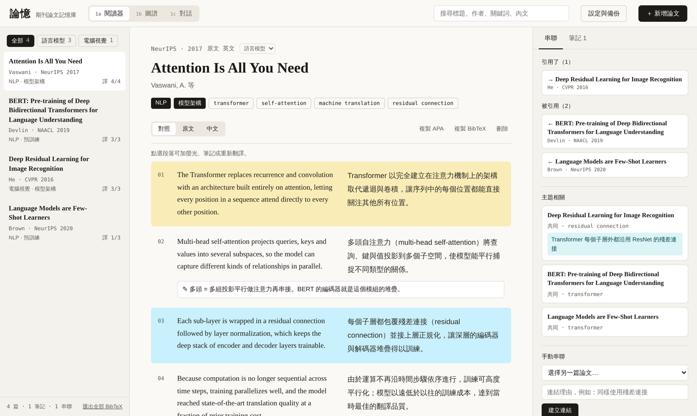
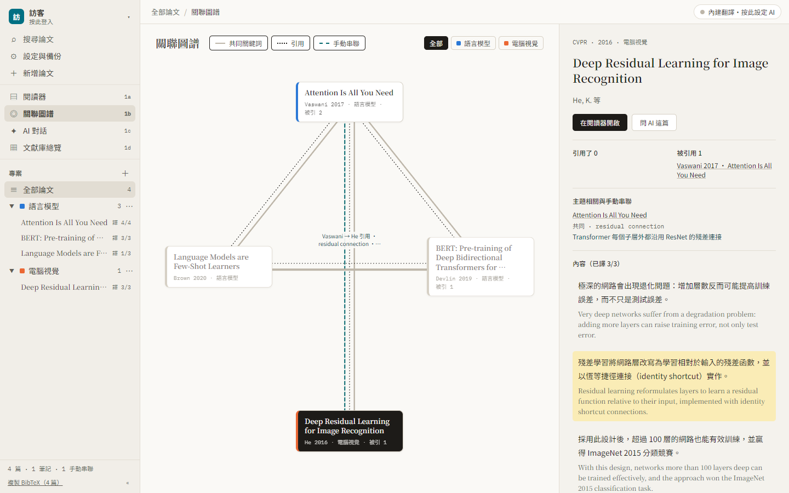
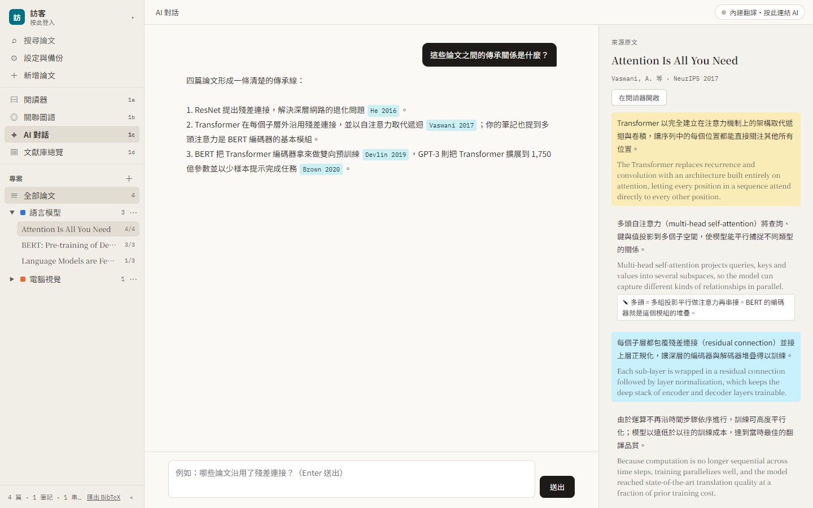
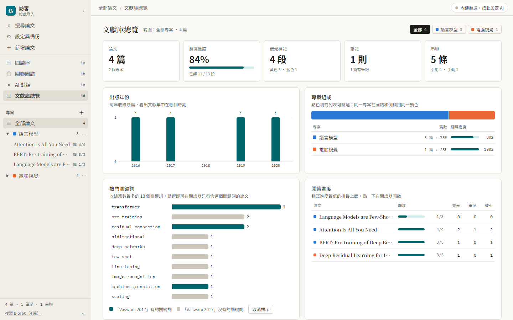
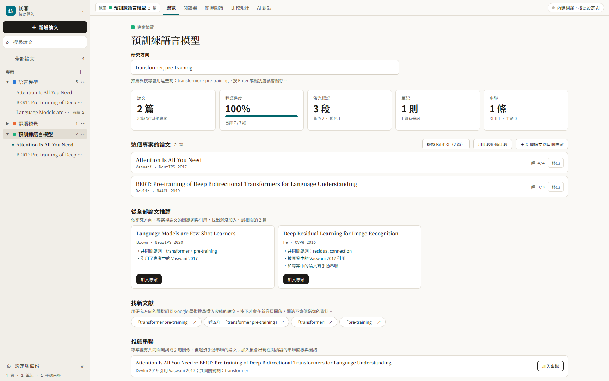
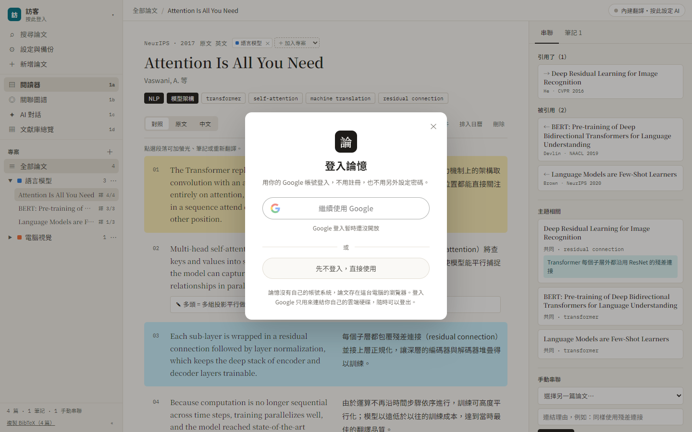

# 論憶：期刊論文記憶庫

給研究生與個人研究者用的論文管理平台。匯入論文後可以逐段翻譯成繁體中文、自動串聯相關論文、做螢光與筆記，並用 AI 查閱整個文獻庫。

- 網站：https://journal-article-memory-tool.vercel.app/（Vercel，推上 main 會自動更新；GitHub Pages 備用網址：https://charleslin2003-prog.github.io/Journal-Article-Memory-Tool/）
- 功能細節：[功能說明.md](功能說明.md)
- 進度與待辦：[待辦事項.md](待辦事項.md)

課程：視覺化分析與決策應用設計（2026 秋）　設計者：林永欽

期中報告投影片：[docs/期中報告_論憶.pptx](docs/期中報告_論憶.pptx)（[PDF 版](docs/期中報告_論憶.pdf)）

管理者操作手冊（開放 Google 登入、讓所有人都有 AI，每一步要貼什麼、按什麼）：[docs/管理者操作手冊_論憶.pptx](docs/管理者操作手冊_論憶.pptx)（[PDF 版](docs/管理者操作手冊_論憶.pdf)）

## 四種工作區

介面仿照 Notion：左側欄是帳號（頭像）、搜尋、設定、四個工作區與專案樹，上方是目前位置（專案／論文）與 AI 狀態。

| 1a 閱讀器 | 1b 關聯圖譜 |
|---|---|
|  |  |
| 原文／中文對照、螢光、段落筆記，右側列出引用與主題相關論文 | 以節點與三種線型呈現共同關鍵詞、引用、手動串聯；選取一篇後，無關的論文淡化 |
| **1c AI 對話** | **1d 文獻庫總覽** |
|  |  |
| 根據整個文獻庫回答，出處可點開看原文 | 關鍵數字、出版年份、專案組成、熱門關鍵詞、閱讀進度，點圖表即可篩選或搜尋 |

**專案首頁**：開一個新的研究方向就建一個專案。專案首頁有研究方向、這個專案的論文、從全部論文推薦（最多 3 篇，附原因）、推薦串聯，以及到 Google 學術找新文獻的連結；選了專案後，閱讀器、圖譜、AI 對話和總覽都只看這個專案的論文。



## 開始使用

主要給桌面版 Chrome／Edge 使用（手機也能開，側欄會變成抽屜）。

1. 開啟網站，內建 4 篇示範論文（Transformer、BERT、ResNet、GPT-3）。網站開放 Google 登入後，第一次使用會跳出「登入論憶」視窗，不用輸入帳號密碼：
   - **繼續使用 Google**：跳出 Google 的帳號選擇視窗，點自己的帳號即可（瀏覽器已登入 Google 時不必再打密碼）。登入後可以同步到雲端硬碟、匯入 PDF、匯出 Google 文件。
   - **先不登入，直接使用**：所有資料仍存在這台電腦。之後按左上角的頭像可以再打開登入視窗。
2. 左側欄的「＋ 新增論文」上傳 PDF 或貼上文字。所有論文都在「全部論文」；要開一個新的研究方向時，按「專案」旁的 ＋ 建立專案，順便填研究方向，就會得到一個乾淨的專案首頁：網站會從全部論文推薦最相關的論文（最多 3 篇，附推薦原因）、建議可以串聯的論文，並產生 Google 學術的搜尋連結。同一篇論文可以放進好幾個專案。
3. 不登入也能翻譯：沒有連結雲端 AI 時，會用瀏覽器內建的翻譯（免費、在你的電腦上執行）。
4. 要用 AI 問答、自動辨識論文資訊、高品質翻譯：到「設定 → 進階」貼上自己的 Gemini 或 Claude API 金鑰，見下方「AI 連線」。
5. 資料存在瀏覽器裡。換電腦前用「設定與備份 → 同步與備份 → 匯出 JSON」，到新電腦再「匯入 JSON」；或設定「雲端同步」，用 Google 雲端硬碟或 GitHub 私人 Gist 自動同步。



## 修改網站

編輯 `src/app.html` 後執行 `python3 tools/build.py`，會重新產生 `index.html`。

## AI 連線

翻譯預設用瀏覽器內建翻譯，不用任何帳號或金鑰。AI 問答等功能使用使用者自己的 API 金鑰，論文內容只會送到使用者選的那一家（Google 或 Anthropic），費用算在使用者自己的帳號；網站作者不必付費，也不需要後端。

| 方式 | 使用者要做的事 | 能做到的事 | 費用 |
|---|---|---|---|
| **瀏覽器內建翻譯**（預設） | 什麼都不用做；第一次使用時下載語言包 | 只有翻譯（英、日、韓、德、法等 → 繁中） | 免費，在使用者電腦上執行 |
| **自備 API 金鑰** | 「設定 → 進階」貼上 Gemini（Google AI Studio 可免費取得）或 Claude 金鑰，存檔前會先驗證 | 翻譯、問答、自動辨識 | 算在金鑰所屬的帳號。Claude Max／Team 方案每月附 API 額度（Max 20x 為 200 美元），在 claude.ai「Settings → Billing → API credits」綁定 Console 組織即可使用，不必另外儲值 |

- **翻譯模式**（設定 → AI 模型）：自動（有雲端 AI 用 AI，沒有用內建）、一律內建、一律雲端 AI。內建翻譯的段落會標「內建翻譯」，點段落可以「用 AI 重新翻譯」。
- **金鑰存在哪裡**：預設勾選「設定 → 進階」的「在這台電腦記住金鑰」，存在瀏覽器的 localStorage；取消勾選則只存在這次工作階段，關閉這個分頁或瀏覽器就清除。這個選項不影響 Google 登入與 Gist 同步權杖。金鑰不會被匯出或同步。
- **做不到的事**：Claude.ai、ChatGPT 的訂閱帳號不能用來登入第三方網站（Anthropic 明文禁止；OpenAI 只開放給受邀合作夥伴），所以用 Claude 要在「進階」貼 API 金鑰。用 Google 帳號直接付 Gemini 費用目前也沒有給一般網站的公開機制。
- **內建翻譯的限制**：需要桌面版 Chrome 138 以上（或支援的 Edge）。它是一般機器翻譯，不會在專有名詞後附原文，也不會刻意使用台灣學術用語。
- 在 Claude 的編輯環境中開啟時，會直接使用該環境內建的 AI。部署在 Vercel 時，也可以由網站代付（見下一節）。

### 部署到 Vercel（金鑰放在伺服器）

1. 用 GitHub 登入 [Vercel](https://vercel.com) → Add New → Project → Import 這個 repo → Deploy（設定維持預設）。
2. Project → Settings → Environment Variables 加入（Type 選 Secret，Environments 選 Production）：
   - `ANTHROPIC_API_KEY`：必填。在 Claude Console 建立金鑰時一定要選工作區（workspace），沒綁工作區的金鑰會被拒絕
   - `LUNYI_ACCESS_CODE`：建議設定，只用半形英數字與符號。設定後，使用者要在「設定 → 進階」填入相同存取碼才能用 AI，避免金鑰被陌生人消耗
   - `LUNYI_MODEL`：選填，預設 `claude-sonnet-5-5`
3. 重新部署（Redeploy）。打開 `https://journal-article-memory-tool.vercel.app/api/claude`，看到 `{"error":"POST only"}` 就代表後端已開啟。

完整的圖文步驟見 [管理者操作手冊](docs/管理者操作手冊_論憶.pdf)。

後端程式在 [`api/claude.js`](api/claude.js)。

## Google 整合

用 Google 登入後可以：

- 從 **Google 雲端硬碟** 搜尋並匯入 PDF（「新增論文 → Google 雲端硬碟」）
- 把論文的翻譯、螢光與筆記匯出成 **Google 文件**（存在雲端硬碟「論憶」資料夾）
- 把閱讀計畫排入 **Google 日曆**
- 用 **Google 雲端硬碟** 同步文獻庫（「設定 → 同步與備份」）
- 每篇論文都有 **Google 學術搜尋** 連結（不需登入）

使用者在登入視窗按「繼續使用 Google」，就會跳出 Google 的帳號選擇視窗。登入用的是 Google 官方的 OAuth（Google Identity Services），網站只在瀏覽器取得 1 小時有效的存取權杖，沒有伺服器會碰到你的資料。

**網站管理者要先建立一次 OAuth 用戶端 ID**，沒有它 Google 不會跳出登入視窗（登入視窗裡的 Google 按鈕會是灰的，顯示「Google 登入暫時還沒開放」）：

1. 到 [Google Cloud Console](https://console.cloud.google.com) 建立（或選擇）一個專案。登入用不到 Vertex AI／Agent Platform，不必啟用。
2. 「API 和服務 → 程式庫」啟用 **Google Drive API**（雲端硬碟同步、匯入 PDF、匯出 Google 文件）和 **Google Calendar API**（排入日曆）。
3. 「API 和服務 → 憑證 → 建立憑證」：
   1. 「您目前使用的是哪個 API？」選哪一個都可以（例如 Google Calendar API），同一個用戶端 ID 兩個 API 都能用。
   2. 「您需要存取什麼資料？」選 **使用者資料** → 下一步。
   3. 如果要求設定 OAuth 同意畫面：應用程式名稱填「論憶」，使用者支援電子郵件與開發人員聯絡資訊填自己的 Gmail。
   4. 範圍（scopes）可以略過，網站用到某個功能時才會請求權限。
   5. 「OAuth 用戶端 ID」：應用程式類型選 **網頁應用程式**，名稱隨意（例如「論憶網站」）。
      「已授權的 JavaScript 來源」加入（只填網域，最後不要加 `/`）：
      - `https://journal-article-memory-tool.vercel.app`
      - `https://charleslin2003-prog.github.io`（GitHub Pages 也開著的話）
      - 本機測試用（選填）：`http://localhost:8765`
      「已授權的重新導向 URI」留空（這個網站用彈出視窗登入，不需要）。
   6. 按「建立」，複製 **用戶端 ID**（`….apps.googleusercontent.com`）。用戶端密鑰（client secret）用不到，不要外流。
4. 「Google Auth Platform → 目標對象」決定誰能登入：
   - 維持「測試中」：只有「測試使用者」名單裡的帳號能登入（最多 100 個），課堂展示時把自己、老師、同學的 Gmail 加進去。
   - 按「發布應用程式」：任何 Google 帳號都能登入。登入只用基本權限（`openid`、`email`、`profile`、`drive.file`），不必送審；但「排入日曆」（`calendar.events`）是敏感權限、「從雲端硬碟匯入 PDF」（`drive.readonly`）是受限權限：通過 Google 驗證前，使用這兩個功能會顯示「Google 尚未驗證這個應用程式」（要按「進階 → 前往論憶」），而且最多只能有 100 位新使用者授權。受限權限的驗證比敏感權限嚴格。
5. 把用戶端 ID 寫進 `src/app.html` 的 `GOOGLE_CLIENT_ID`，執行 `python3 tools/build.py` 再 push。之後使用者不必設定任何東西，按左上角頭像 →「繼續使用 Google」→ 在 Google 的視窗點自己的帳號就登入了。
   只想自己先試的話，也可以貼到網站「設定 → 進階 → Google OAuth 用戶端 ID」（只對這台瀏覽器有效）。

用戶端 ID 本來就會出現在網頁裡，可以公開，不是密碼；Google 只接受從上面登記的網址發出的登入。
應用程式維持「測試」狀態時，只有加入測試使用者名單的帳號能登入，Google 也會顯示「未經驗證的應用程式」提示，這是正常的。只用基本權限（登入、雲端硬碟同步、匯出文件）發布後不必送審；要讓所有人都能使用匯入 PDF 與排入日曆，才需要送 Google 驗證。

各功能用到的權限（第一次使用該功能時才會請求）：

| 功能 | 權限 |
|---|---|
| 登入、雲端硬碟同步、匯出 Google 文件 | `drive.file`（只能存取論憶自己建立的檔案） |
| 從雲端硬碟匯入 PDF | `drive.readonly` |
| 排入 Google 日曆 | `calendar.events` |

## 檔案

```
index.html          單一檔案網站（約 370 KB，含 React 與執行環境），由 tools/build.py 產生
src/app.html        網站原始碼（版面＋程式），要改網站就改這個
tools/build.py      把 src/app.html 打包回 index.html
api/claude.js       Vercel Serverless Function，代為呼叫 Anthropic API
docs/screenshots/   功能截圖（桌面四個工作區、專案首頁、設定、登入視窗、手機版）
docs/期中報告_論憶.pptx  期中報告投影片（附講稿備註），另有 PDF 版
docs/管理者操作手冊_論憶.pptx  管理者操作手冊：Google 登入與網站後端 AI 的設定步驟，另有 PDF 版
docs/瀏覽器插件方案.md   做成 Chrome 插件／Google 生態工具的方案比較與路線圖
功能說明.md          完整功能說明
待辦事項.md          已完成與未完成工作
```

## 使用限制

- PDF 最多擷取前 150 頁、300 段；掃描版 PDF 的 OCR 最多 60 頁。
- 寬度 900px 以下為單欄手機版面。
- 瀏覽器 localStorage 約 5 MB，論文很多時請定期匯出備份。
