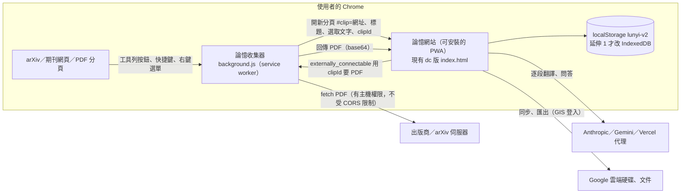
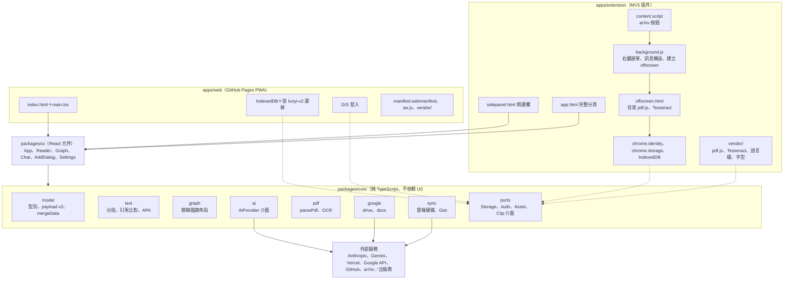
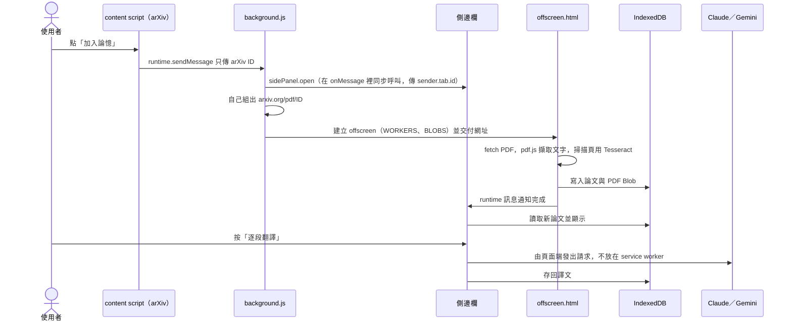

# 論憶：瀏覽器插件與「在自己電腦使用」方案建議書

- 撰寫日期：2026-10-22。政策與 API 狀態以當天查得到的官方文件為準。
- 2026-10-23 更新：主要網址改為 https://journal-article-memory-tool.vercel.app/ （GitHub Pages 只當備用）。下文的程式草稿已改用 Vercel 網址；PWA `id` 的說明與品牌驗證段落是以 GitHub Pages 寫的，實作時要依 Vercel 網址重新確認。
- 對象：論憶設計者（課程「視覺化分析與決策應用設計」，2026 秋）。
- 時程假設：期末展示約在 2027 年 1 月中，從 2026-10-26（週一）起算約 12 週，其中第 9–10 週（12/21–2027/1/3）橫跨聖誕與跨年。原本假設每週可投入 10–15 小時，這個假設偏高，所以期末主目標刻意壓在前 3 週完成。實際期末日期請自行對照調整。
- 標記說明：
  - 「待確認」表示官方文件沒寫清楚，或查證時查不到，必須實測或再查。
  - 「官方文字間接支持」表示官方沒有直接寫明，但現有的官方文字可以推得這個結論。
  - 文中工時都是依程式規模推估的粗估，沒有實際做過。
- 本機程式狀態（2026-10-22，用 `wc -l`、`ls -l` 實測本機工作目錄）：`src/app.html` 共 1,478 行（約 140 KB）。模板（`<x-dc>` 區塊）約 500 行，有 35 個 `<sc-for>`、47 個 `<sc-if>`、2 個 `<sc-raw-select>`、90 個 `sc-camel-on-*` 事件屬性（click 65、change 23、key-down 2）、16 個 `style-hover`；元件邏輯 `class Component` 約 800 行，最後是 `renderVals()`。打包後的 `index.html` 約 250 KB（254,175 位元組）。

## 查證說明

本文件經過一輪逐條事實查核（2026-10-22）。已修正的重點：

1. **結論調整**：期末主目標改成「A 收集器插件＋B PWA 可安裝網站」；「Vite＋React 共用核心改寫＋C 完整 MV3 插件」降為延伸目標（時間足夠再做，或寒假後）。第 1 節結論、第 3 節推薦組合、第 4 節路線圖已一致修改。
2. **儲存與金鑰**：`chrome.storage.local` 上限改正為 10 MB（Chrome 114 起）；補上 `storage.session` 在插件停用、重新載入或更新時也會清空；補上商店要求使用者資料「以強加密方式靜態儲存」對金鑰與權杖的影響。
3. **上架與 OAuth**：註冊費（2020 年公告為 US$5，所有開發者使用資訊主頁前都要先付，官方固定插件 ID 的流程也一樣）、台灣在可註冊國家內、名額可以申請提高、自己產生 `key` 的 ID 風險、OAuth 發布狀態是專案層級、github.io 的品牌驗證方式。
4. **技術細節**：sandbox 頁面與 `blob:` 腳本、MV3 規定對隔離環境的遠端程式碼例外、Picker 在插件頁面一定被擋、完整版 manifest 改成最小主機權限、PWA manifest `id` 與安裝條件、內建 AI 硬體需求的適用範圍、`sidePanel.open()` 的觸發來源、`message_serialization` 的舊版行為、桌面 App 簽章成本的說法。
5. **程式碼草稿**：修正收集器 `background.js` 忽略 `permissions.request` 結果的 bug；提醒階段 1 的 `sw.js` 要避開 `/next/`。
6. **程式位置**：過時的行號全部改成函式或常數名稱，程式統計重新量測。

---

## 1. 結論

建議期末只做「收集器插件＋可安裝網站」，網站本體不改寫，省下的時間投入課程真正評分的視覺化與決策分析。

**期末主目標：A 收集器插件＋B PWA 可安裝網站（約 3 週完成）**

- 網站本體（dc 版 index.html）幾乎不動，只加一段接收程式和 PWA manifest。
- 做完後可以在 Chrome 把論憶裝成獨立視窗的 App，也能在任何網頁一鍵把論文送進論憶。多數出版商的 PDF 沒開 CORS，網站自己抓不到，這部分改由插件下載後交給網站。
- 這樣已經滿足「在自己電腦使用」和「網頁插件」兩個需求，又不必改寫網站。

**省下的時間：投入視覺化與決策分析本身**

第 4–11 週以視覺化（關聯圖譜、總覽、儀表板）和決策分析（例如「下一篇該讀哪篇」）為主，見第 4 節階段 2。

**延伸目標（時間足夠再做，或寒假後）：Vite＋React 共用核心改寫＋C 完整 MV3 插件**

同一份程式同時產出網頁版和完整的 MV3 插件（側邊欄＋完整分頁）：

- pdf.js、Tesseract 全部打包進套件。
- 登入改用 `chrome.identity`。
- 資料改存 IndexedDB。
- Google 權限只留 `drive.file` 這類非敏感範圍，日曆改用 .ics 或「加入日曆」連結。這樣 OAuth 不必經過驗證就能切到正式版。

**為什麼把改寫降為延伸目標**

1. 時程：12 週橫跨聖誕與跨年（第 9–10 週是 12/21–2027/1/3），每週 10–15 小時的假設本身就偏高。
2. 工時排不下：改寫階段（延伸 1）的子項合計 44–72 小時，還沒算進日曆改 .ics 和拿掉 `drive.readonly` 後的替代流程。
3. 送審時間：完整插件（延伸 2）如果要在期末前上架，第 9–10 週就要送審，那時功能還沒做完，等於送半成品。
4. 評分效益：這門課評的是視覺化與決策分析，基礎建設改寫的評分效益有限。

**不建議的兩條路**

- 直接把 index.html 包進插件：dc-runtime 用 `new Function` 執行程式，在插件頁面一定會被 CSP 擋下。改用 sandbox 包裝又拿不到儲存和登入（見 3.1）。
- 做桌面 App：Google 登入要重寫成「系統瀏覽器＋loopback＋PKCE」；多出一條發行管線要維護；對課程主題的加分也有限。程式碼簽章不是主要障礙（見方案 E）。

**決策關卡**

- 第 3 週結束：收集器和 PWA 的驗收還沒全部通過，就先把它做完，不開新項目。
- 第 7 週結束：期末要展示的視覺化與決策分析已經能展示、實際每週投入也跟得上，才開始延伸目標；否則延伸目標整個移到寒假後。

---

## 2. 現況限制：為什麼不能直接把 index.html 包成插件

### 2.1 dc-runtime 需要 `'unsafe-eval'`，插件頁面不允許

index.html 是 Claude Design 的打包格式，有三個地方在插件頁面會出問題：

1. 外殼裡有多段 inline `<script>`。
2. React 18 UMD 和 dc-runtime 是用 gzip+base64 內嵌，執行時再轉成 `blob:` URL 載入。
3. dc-runtime 用 `new Function(...)` 執行元件程式碼。

MV3 的規定如下：

- 插件頁面（側邊欄、完整分頁、popup、offscreen）的 CSP 預設是 `script-src 'self'; object-src 'self'`。
- 最寬只能放到 `script-src 'self' 'wasm-unsafe-eval'; object-src 'self'`。
- 在 script-src 加 `'unsafe-eval'`，安裝時就會報錯。inline script 和遠端腳本也都不允許。

所以上面三件事在插件頁面全部會被擋。

唯一的例外是 sandbox 頁面：它預設允許 `'unsafe-inline' 'unsafe-eval'`，但 CSP 不能含 `allow-same-origin`，拿不到任何 `chrome.*` API，只能用 `postMessage` 和外層溝通。另外要注意 `blob:` 腳本：

- 預設 sandbox CSP 的 `script-src` 是 `'self' 'unsafe-inline' 'unsafe-eval'`，其中 `'self'` 不涵蓋 `blob:`，所以外殼用 `blob:` 載入的 React 和 dc-runtime，預設很可能被擋。
- sandbox CSP 可以自訂，唯一限制是不能含 `allow-same-origin`。可以在 `script-src` 加上 `blob:` 再實測。
- 以上是依 CSP 規範的推論，官方文件沒有直接說明，待實測。後果見 2.3 與 3.1。

### 2.2 遠端程式碼：pdf.js、Tesseract、GIS、Picker

Chrome 官方對「遠端託管程式碼」的定義是：瀏覽器執行、但不是從插件自己的檔案載入的任何東西。WASM 也算，JSON、CSS 這類資料不算。第三方函式庫在執行時才去抓的程式碼同樣算違規。Chrome 線上應用程式商店把「`<script>` 指向套件外資源」和「eval 遠端字串」都列為違規範例。

商店的 MV3 規定也明列了例外：在與插件 API 隔離的環境（iframe、sandbox 頁面）裡執行的程式碼，不受遠端程式碼限制。這個例外是 3.1 評估 sandbox 路線、以及下表 Picker 那一列的依據。

| 元件 | 現在怎麼載入 | 插件裡要怎麼改 |
|---|---|---|
| pdf.js 4.4.168 | 常數 `PDFJS` 是 jsDelivr 網址，`parsePdf()` 裡用 `import()` 動態載入，worker 也指向同一個網址 | 用 npm 打包。`workerSrc` 指向 `chrome.runtime.getURL(...)`，`getDocument` 傳 `isEvalSupported:false`。研究時實測 pdf.min.mjs 加 worker 約 1.7 MB |
| Tesseract.js 5.1.1 | 常數 `TESS` 是 jsDelivr 網址，`parsePdf()` 的 OCR 分支用 `loadScript()` 插入 `<script>`，執行時再下載 worker、wasm core 和 eng+chi_tra 語言檔 | worker 和 4 個 `tesseract-core*.wasm.js` 都打包進套件；`workerPath`、`corePath`、`langPath` 改指向本地。`workerBlobURL:false` 是社群做法（待實測）。語言檔依定義屬於「資料」，但建議也打包（實測 eng 約 2.95 MB、chi_tra 約 1.66 MB，gz 壓縮後）。OCR 相關檔案合計約 10 MB 等級 |
| Google Identity Services | 常數 `GSI`（`https://accounts.google.com/gsi/client`），在 `componentDidMount()` 和 `gToken()` 裡用 `loadScript()` 載入 | Google 明說這個函式庫不支援 Chrome 擴充功能，也不支援自行託管。改用 `chrome.identity.getAuthToken`，見 2.5 |
| Google Picker（目前沒用，是方案 D 的選項） | 要從 `apis.google.com` 載入 gapi 腳本 | 在插件頁面屬於遠端託管程式碼，一定被擋，這是根本限制，不只是「沒有官方範例」。只能放進 sandbox 頁面或 iframe（依上面的例外不受限），再用 `postMessage` 把權杖傳進去；或乾脆只在網頁版做 |
| Google Fonts | `componentDidMount()` 動態插入 `<link>` 載入 CSS | CSS 不算程式碼，但為了離線和隱私，建議打包少量字重或改用系統字型 |

送審前要搜尋整個套件，確認沒有殘留 `cdn.jsdelivr.net` 之類的預設網址。曾有人因為 Tesseract 的預設 CDN 路徑還留在套件裡，被商店以「遠端程式碼」退件（社群回報）。

### 2.3 localStorage 容量，以及 sandbox 的「假裝有存」陷阱

- 文獻庫存在 localStorage 的 `'lunyi-v2'`（常數 `KEY`），每個 origin 上限約 5 MiB，放不下 PDF 原檔。
- MV3 的 service worker 根本不能用 localStorage。
- 沒有 `allow-same-origin` 的 sandbox 頁面是 opaque origin（Origin 為 null），存取 localStorage 會丟出例外。現有程式把這些例外都吞掉了：
  - `init()` 讀取文獻庫時會靜默失敗，退回內建的範例資料。
  - 金鑰和設定的 `lsGet()`／`lsSet()` 會靜默失敗。
  - `componentDidUpdate()` 存檔處會跳出「儲存空間已滿，請刪除部分論文」，這個訊息是誤導的。

  結果是畫面看起來能用，實際上什麼都沒存下來。
- 插件裡的替代方案：
  - 文獻庫改用 IndexedDB，搭配 `unlimitedStorage` 權限。這個權限適用 `chrome.storage.local`、IndexedDB、Cache Storage 和 OPFS，安裝時不顯示警告。
  - `chrome.storage.local` 上限 10 MB（Chrome 114 起；Chrome 113 以前為 5 MB）。
  - `chrome.storage.sync` 的總量 `QUOTA_BYTES` 為 102400 位元組（約 100 KB），只能放設定。

### 2.4 金鑰與權杖保存

- 目前存在 localStorage 的機密資料有：`lunyi-apikey`（Anthropic）、`lunyi-gemini-key`、`lunyi-g-token`（Google 存取權杖）、`lunyi-gh-token`（GitHub 權杖，給 Gist 用）、`lunyi-code`（Vercel 存取碼）。
- GitHub Pages 的專案網站共用同一個 origin `https://charleslin2003-prog.github.io`，而 localStorage 和 IndexedDB 是依 origin 分開的。也就是說，這個帳號將來在其他 repo 開的任何 Pages 網站，都讀得到上面這些金鑰。
- Gemini API 官方文件明說不要把金鑰放在用戶端程式（使用者可以把它擷取出來），建議改用後端代理。2026 年的變動：
  - 2026-05-07 起，長期閒置且沒有限制的金鑰會被封鎖。
  - 2026-05-28 起，AI Studio 新建的金鑰一律是綁定 service account 的 auth key。
  - 沒有限制的 standard key 會被拒絕（文件沒寫生效日期）。
- 官方文件沒說 `chrome.storage.local` 有加密。官方建議敏感資料放 `chrome.storage.session`：只存在記憶體，瀏覽器重開會清空；插件停用、重新載入或更新版本時也會清空。

**商店對使用者資料的要求，以及對論憶的影響**

商店的使用者資料 FAQ 要求使用者資料以 HTTPS 傳輸，並「以 RSA 或 AES 等強加密方式靜態儲存」。影響評估：

- **期末主目標（A＋B）**：收集器只在 `storage.session` 暫存 `clipId` 和 PDF 網址，不保存任何金鑰。金鑰仍在網站的 localStorage，網站不受商店政策約束，但上面講的共用 origin 風險仍在。收集器只用開發人員模式展示，也不經過審查。
- **延伸 2 上架時**：Anthropic、Gemini 金鑰，GitHub 權杖和 Vercel 存取碼如果明文放在 `storage.local` 或 IndexedDB，可能被認定不符合要求（審查實際怎麼認定，待確認）。Google 權杖改用 `chrome.identity.getAuthToken` 後由 Chrome 自己快取，插件不必再另外保存 `lunyi-g-token`。
- **建議做法（可以並用）**：
  1. 預設「只在這次工作階段記住」：放 `storage.session`。介面要講清楚：關掉瀏覽器、停用或重新載入插件、插件更新版本後，都要重新輸入。
  2. 需要長期保存時，先用 Web Crypto（AES-GCM）加密再存；加密用的金鑰做成不可匯出（`extractable: false`）的 `CryptoKey`，存在 IndexedDB。這符合「以 AES 加密靜態儲存」的字面要求，但密文和金鑰在同一台電腦上，擋不住能在插件裡執行程式的人。這樣是否足以通過審查，待確認。
  3. 改走 Vercel 代理：金鑰只放在伺服器上，插件只保存存取碼。這也是 Gemini 官方建議的方向。存取碼本身也是機密，比照 1 或 2 處理。

### 2.5 GIS 在插件裡不能用，相對路徑 `api/claude` 也會失效

- 登入要改走 `chrome.identity.getAuthToken`，步驟是：在 Google Cloud 建立「Chrome Extension」類型的 OAuth 用戶端並填入插件 ID；manifest 加 `oauth2` 和 `identity` 權限；再用 manifest 的 `key` 欄位固定插件 ID。自己產生 `key` 的社群做法有「上架後 ID 改變」的風險，見 8.1。
- 副作用是 `client_id` 會寫死在 manifest 裡，設定頁「讓使用者自己填 OAuth 用戶端 ID」（`gClient()` 讀的 `lunyi-g-client`）在插件版就不再適用。所有使用者都會受開發者那個 Cloud 專案的發布狀態影響。
- Microsoft Edge 不支援 `identity.getAuthToken`，要另外改用 `launchWebAuthFlow`。
- AI 後端：AI shim（`<x-dc>` 模板之後那段 inline `<script>`）裡用相對路徑 `fetch('api/claude')`。在 `chrome-extension://` 底下這個路徑會失效，要改成 Vercel 的絕對網址。Vercel 代理沒開 CORS，所以要加進 `host_permissions`（見 7.2）。
- `planReading()` 建立的日曆事件描述會帶 `location.href`，在插件裡這會變成 `chrome-extension://` 網址，要改成網站網址或拿掉。

### 2.6 打包格式可能被當成混淆（待確認）

商店允許的程式碼縮減方式只列了三種：移除空白、註解和區塊分隔符；縮短變數名稱；合併檔案。gzip+base64 加上執行時才解開，不在這份清單內。官方沒有明說 base64 算混淆，有退件風險是推論。這也是完整插件建議改寫成一般建置的原因之一。

---

## 3. 方案比較

| 方案 | 使用者體驗 | 能做到的事 | 開發量（兼職估計） | 成本 | 主要風險 |
|---|---|---|---|---|---|
| **A 最小可行收集器插件**＋現有網站 | 在任何網頁按工具列按鈕、快捷鍵或右鍵，就會開出論憶網站並預填「新增論文」。閱讀、圖譜、問答仍在網站分頁進行 | 送出目前頁面、選取文字、PDF 連結；由插件下載沒開 CORS 的 PDF 再交給網站。權限只有 contextMenus、activeTab、storage | 12–20 小時 | 0 元（開發人員模式） | 只轉送到網站的插件，上架時可能被認定違反「最低功能」政策；不是完整的插件體驗 |
| **B PWA 可安裝網站** | 從 Chrome／Edge 選單安裝成獨立視窗，出現在開始選單和工作列，斷網也能開啟 | 獨立視窗、離線殼層、改用 IndexedDB 突破 5 MB；桌面版可以「用論憶開啟」PDF（file_handlers）、把文獻庫存成本機資料夾（File System Access）；Android 可以當分享目標；可以接 Chrome 內建 Translator、Summarizer（Chrome 138 起網頁也是 stable） | 最低門檻 8–12 小時；完整版 50–80 小時 | 0 元（GitHub Pages）。想上 Microsoft Store 的話，個人開發者註冊免費（只適用 storedeveloper.microsoft.com 的新流程） | 外殼會把整個 `<html>` 換掉，manifest link 要寫進模板；Service Worker 更新策略寫錯會卡在舊版，scope 也會涵蓋之後的 `/next/`；同帳號的 Pages 共用 origin；iOS 主畫面 App 的儲存和 Safari 分開 |
| **C 完整 MV3 插件**（側邊欄＋完整分頁） | 點工具列圖示開側邊欄，和 arXiv、PDF 並排；寬版閱讀和圖譜在完整分頁 | 側邊欄、右鍵選單、arXiv 按鈕、背景 OCR（offscreen）；pdf.js 和 Tesseract 可離線；chrome.identity 登入；IndexedDB＋unlimitedStorage；可以上架 | 改寫加插件約 80–130 小時（約 8–12 週），另有未計入項目 | 開發人員模式 0 元；上架要付一次性註冊費（2020 年公告為 US$5，所有開發者使用資訊主頁前都要先付，見 8.3） | 必須脫離 dc-runtime 改寫 UI；打包後殘留 CDN 網址會被當成遠端程式碼；網頁版和插件版是不同 origin，資料只能靠同步或匯出入互通；金鑰要符合商店的靜態加密要求（見 2.4） |
| **D Google 生態深度整合**（疊在 B 或 C 上） | 用 Google 帳號一鍵登入，不用自己貼 OAuth 用戶端 ID；資料存在自己的雲端硬碟 | chrome.identity 登入、雲端硬碟同步、匯出 Google 文件（只用 drive.file）、日曆改 .ics 或連結；Picker 選檔（只能在網頁版，或插件裡的 sandbox／iframe）；Docs 外掛插入引用（加分） | 最小版約 3 週；含 Docs 外掛約 5–7 週 | 只用非敏感範圍時 0 元，不必驗證 | 插件頁面不能載入 Picker 需要的 gapi 腳本（遠端託管程式碼），只能放進 sandbox／iframe 再用 postMessage 傳權杖，或改在網頁版做；網頁版和插件版兩個 OAuth 用戶端能不能看到彼此的 drive.file 檔案，待確認；保留 drive.readonly 又公開上線，大概率要做 CASA 安全評估 |
| **E 桌面 App**（Tauri 2 為主，Electron＋MSIX 為備案） | 安裝成一般的 Windows 或 macOS 程式，資料放在 $APPDATA 或自選資料夾 | 現有 index.html 幾乎不用改就能跑（桌面殼沒有 MV3 的 CSP 限制）；OCR 完全離線；本機檔案儲存；用 GitHub Releases 自動更新 | 5–7 週；只做 Windows、不簽章的最小版約 3 週 | Windows 不簽章 0 元，但會跳 SmartScreen 警告。降低簽章成本的管道：透過 Microsoft Store 上架 MSIX，由微軟免費重新簽章；開源專案可以申請 SignPath Foundation 免費簽章。自購憑證的話 OV 約每年 US$150–300，EV 憑證從 2024 年起已不能直接略過 SmartScreen。Microsoft Store 個人開發者免費註冊只適用 storedeveloper.microsoft.com 的新流程。macOS 簽章要付 Apple 開發者年費 | 在桌面 webview 裡開 GIS 彈窗，屬於 Google 禁止的嵌入式瀏覽器，登入要改寫成系統瀏覽器＋loopback＋PKCE；多出一條發行管線要維護；對課程主題的加分有限 |

**推薦組合**：期末主目標是 A＋B（B 先做最低門檻），省下的時間投入視覺化與決策分析。C＋D（只用非敏感範圍的版本）降為延伸目標，時間足夠再做，或寒假後。D 裡不依賴插件的部分（網頁版收斂 Google 權限、網頁版 Picker 選檔）可以疊在 B 上當選做。E 不做。

### 3.1 為什麼不走「sandbox 包裝」的捷徑

把現有 index.html 登記成 sandbox 頁面、再用 iframe 嵌進側邊欄，有機會「幾乎不改就跑起來」。政策上也不一定違規：依商店的 MV3 規定，在 sandbox 頁面這類隔離環境執行的程式碼不受遠端程式碼限制，連外殼從 jsDelivr 載入 pdf.js、Tesseract 都可能被允許（前提是自訂的 sandbox CSP 放行這些來源，待實測）。但仍有幾個問題：

1. 儲存、Google 登入、目前分頁資訊都得自己寫 postMessage 橋接，工作量跟抽出 adapter 差不多。
2. 寫出來的橋接程式在正式版用不到。
3. 外殼的 `blob:` 腳本在預設 sandbox CSP 底下很可能被擋，要自訂 sandbox CSP 加上 `blob:` 再實測（見 2.1，屬於推論）。
4. 打包格式可能被當成混淆的疑慮（2.6）還在。

同樣是為了期末展示，收集器加 PWA 的路線資料只存在一處，風險比較低。

### 3.2 競品定位（寫期末報告用）

- **Paperpile**：網頁 App、Chrome 插件、Google 文件外掛，沒有桌面 App，PDF 可以同步到使用者自己的雲端硬碟，而且只碰透過它上傳的檔案。這種形態最接近論憶想做的「Google 生態工具」。
- **Zotero**：以桌面 App 為主。Connector 插件透過本機 `127.0.0.1:23119` 把資料送進桌面版，本機還提供 `localhost:23119/api/` 讀取書目。論憶可以做成「讀取 Zotero 文獻庫」的互通工具，不必跟它正面競爭。
- **Gemini Notebook**（NotebookLM 在 2026-07-16 改名）：免費方案每本筆記本 50 個來源，額度可能變動。期末報告要正面回答「為什麼不用它」。
- **Translate for Zotero**（AGPL-3.0）、**沉浸式翻譯**：已經涵蓋「在 Zotero 裡翻譯」和「雙語對照閱讀」。AGPL 有傳染性，不要直接併入這些程式碼。
- **論憶的差異化**可以寫成：繁中逐段對照的譯文會存成可搜尋的文獻庫資產（不是看完就消失的頁面翻譯）、關聯圖譜視覺化、本機優先加自備金鑰免訂閱，並且可以和 Zotero 互通。

---

## 4. 推薦路線圖

原則：資料格式全程不改（papers／links／notes／qa／gone，payload version 2），所以每個階段失敗都能退回上一版，JSON 備份也能在各版本之間互通。

週次對照（從 2026-10-26 週一起算）：

| 週次 | 日期 | 內容 |
|---|---|---|
| 第 1 週 | 10/26–11/1 | 階段 0；階段 1 開始 |
| 第 2–3 週 | 11/2–11/15 | 階段 1；第 3 週結束是決策關卡 1 |
| 第 4–7 週 | 11/16–12/13 | 階段 2；第 7 週結束是決策關卡 2 |
| 第 8–11 週 | 12/14–2027/1/10 | 階段 2 收尾。第 9–10 週（12/21–1/3）是聖誕與跨年，預設進度會放慢；有餘裕才碰延伸目標 |
| 第 12 週 | 1/11–1/17 | 展示準備與緩衝 |

### 期末主目標

#### 階段 0：準備與關鍵實測（第 1 週，原估 6–10 小時，實際會少一些）

- ~~把本機最新版（含 Google 整合）合併後部署到 GitHub Pages。~~ **已完成**：2026-10-22 已合併到 main 並部署，同時新增了 1d 文獻庫總覽。
- 決定插件 ID 的固定方式（見 8.1），在 manifest 寫入 `key`：
  - 確定之後要上架：第 1 週就付註冊費、上傳草稿，用官方流程取得公鑰。
  - 只在開發人員模式展示：可以用社群做法自己產生，但要知道之後上架時 ID 可能不同，要重做哪些東西見 8.1。
- 實測：Chrome 內建 PDF 檢視器的分頁裡，右鍵選單和 `tab.url` 能不能正常取得（待確認）。
- 移到延伸 2：新增「Chrome Extension」類型的 OAuth 用戶端、drive.file 跨用戶端可見性的實測。收集器用不到 Google 登入。
- **驗收**：實測結果寫進 `docs/`。

#### 階段 1：收集器插件＋可安裝網站（第 1–3 週，約 20–32 小時）

**1a 收集器插件（12–20 小時）**

- 寫 `background.js`：工具列按鈕、`Alt+Shift+L` 快捷鍵、右鍵選單（頁面、選取文字、PDF 連結）。
- PDF 由 service worker 下載。網站只能憑 `clipId` 來要檔案，不能叫插件去下載任意網址。
- 跨網域的 PDF 要在使用者動作中請求權限。使用者拒絕（或請求失敗）時，仍然送出 clip，但不附 PDF，並讓網站提示使用者手動下載（見 7.1 的程式草稿）。
- 網站端在 `src/app.html` 加約 50 行接收程式（`#clip=` 雜湊加 `externally_connectable`），改完用 `python tools/build.py` 打包。
- 接收程式只預填「新增論文」對話框，絕不自動存檔、也不自動呼叫 AI，因為任何人都能造出 `#clip=` 連結。
- 現有的 `parsePdf(file)` 不會呼叫 AI（AI 擷取書目資料是在 `addPaper()` 才做），可以直接拿來用。

**1b PWA 最低門檻（8–12 小時）**

- 新增 `manifest.webmanifest`，建議明寫 `"id": "/Journal-Article-Memory-Tool/"`。這不是必須：完全省略時會退回用 `start_url`，結果一樣；只有寫成 `"./"` 或 `"/"` 才會變成整個帳號網域（見 7.4）。
- 圖示準備 192、512 和 maskable 三種。
- `<link rel="manifest">` 要寫進 `src/app.html` 模板的 `<head>`，外殼也放一份。原因是外殼會用 `replaceWith` 換掉整個 `<html>`。換頁後才插入的 manifest 能不能被 Chrome 偵測到，待實測。
- `sw.js`：導覽請求先走網路，逾時再退回快取。
- `sw.js` 要避開 `/next/`：scope 是 `/Journal-Article-Memory-Tool/` 時，會攔截之後延伸 1 部署在 `/Journal-Article-Memory-Tool/next/` 的導覽請求。現在就讓 fetch 處理器遇到 `/next/` 開頭的請求直接 return（不呼叫 `respondWith`），或另外限制 scope。
- `build.py` 產生版本雜湊寫進 sw.js，並在介面顯示「有新版本，請重新整理」。

**驗收：**

- 四種情境都能打開預填好的「新增論文」對話框：
  1. arXiv PDF（有開 CORS）
  2. ACL Anthology 或 CVF 的 PDF（研究時實測沒開 CORS）
  3. 一般網頁的選取文字
  4. Chrome PDF 檢視器分頁
- 拒絕下載權限時，對話框照樣打開，並看得到「PDF 沒有一起帶過來」的提示。
- 把 zip 拿到另一台電腦，用開發人員模式載入後，插件 ID 跟原本一樣。
- Chrome 選單出現「安裝論憶」；安裝後以獨立視窗開啟；斷網重開仍看得到介面和已存的資料。
- DevTools 的 Application → Manifest 頁沒有錯誤。

> 到這裡就完成期末主目標的系統部分：「在自己電腦安裝的論憶 App＋從任何網頁收集論文的 Chrome 插件」。

#### 階段 2：視覺化與決策分析（第 4–11 週，期末主軸）

- 這門課評的是視覺化與決策分析，把階段 0–1 之後的時間都放在這裡，評分效益比基礎建設改寫高。
- 現有素材：關聯圖譜、總覽、儀表板的圖表（`yearChart()`、`folderChart()`、`kwChart()`），以及階段 1 之後由收集器帶進來的論文。
- 方向舉例（具體題目請依課程評分標準決定）：讓圖譜和總覽直接回答「下一篇該讀哪篇」「哪個主題的文獻還不夠」這類決策問題；把新收集的論文和既有文獻庫的關聯呈現出來。
- 選做（Google 生態，不需要改寫）：
  - 在現有 dc 版上收斂 Google 權限：`planReading()` 的日曆改成 .ics 下載或「加入 Google 日曆」連結（約 1–2 天）、拿掉 `driveSearch()`／`drivePick()` 用的 `drive.readonly`（替代做法見第 5 節，工時未估）。做完才能把 OAuth 切到正式版，展示當天不會遇到 7 天重新授權（見 8.4）。
  - 網頁版用 Picker 加 `drive.file` 從雲端硬碟選 PDF，取代 `drive.readonly`。
  - PWA 版接上 Chrome 內建 Translator、Summarizer（Chrome 138 起網頁也是 stable），當免金鑰的翻譯和摘要備案。硬體與作業系統需求見第 5 節。
  - PWA 加上 `file_handlers` 和 `launch_handler`，讓 PDF 可以「用論憶開啟」。
- **驗收**：期末要展示的視覺化與決策分析功能，用自己的文獻庫實際跑過一輪。

> **決策關卡 1（第 3 週結束）**：階段 1 的驗收還沒全部通過，就先把它做完，不開新項目。
>
> **決策關卡 2（第 7 週結束）**：只有在期末要展示的視覺化與決策分析已經能展示、實際每週投入也跟得上時，才開始延伸目標；否則延伸目標整個移到寒假後。就算開始了，期末前也只做到開發人員模式或 `/next/` 預覽，不送審（理由見延伸 2）。

#### 加分項目（有餘力才做，不限主線或延伸）

- arXiv 頁面的「加入論憶」按鈕（content script，可以加在收集器上；安裝時會列出 arxiv.org）；Google 學術結果頁的按鈕（約 3–5 天，注意第 9.4 節的條款限制）。
- Google 文件的 Editor add-on（Apps Script）：在游標處插入 APA 引用。用測試部署分享，不上 Marketplace（約 1–2 週）。不依賴插件。

#### 第 12 週：展示準備與緩衝

### 延伸目標（時間足夠再做，或寒假後）

降級理由見第 1 節。以下保留原本的規劃，供之後接著做。

#### 延伸 1：共用核心改寫（原階段 2，子項合計約 44–72 小時，另有未計入的項目）

- 建立 Vite + React 骨架和 npm workspaces，用 GitHub Actions 部署到 Pages（6–10 小時）。
- 機械式轉換（15–25 小時）：
  - `class Component extends DCLogic` 改成 `class App extends React.Component`，方法原樣保留，`render()` 先呼叫 `renderVals()` 再回傳 JSX。
  - `<sc-for>`（35 個）改成 `.map()`（加 key），`<sc-if>`（47 個）改成 `&&`。
  - `sc-camel-on-*` 改成 React 事件：`sc-camel-on-click` → `onClick`、`sc-camel-on-change` → `onChange`、`sc-camel-on-key-down` → `onKeyDown`（保留 `e.nativeEvent.isComposing` 的輸入法組字判斷）。
  - `<sc-raw-select>`（2 個）改回原生 `<select>`，當成受控元件（`value`＋`onChange`），裡面的 `<option>` 照搬。
  - inline style 字串改成物件，`style-hover`（16 處）改成 CSS class。
  - 可以寫個轉換腳本先跑一遍，再人工修正。
- 抽出 `core` 和各個 adapter，為 `splitParas()`、`mergeData()`、AI 回應解析寫單元測試（15–25 小時）。
- 網頁版 adapter（8–12 小時）：改用 IndexedDB，第一次啟動時從 `lunyi-v2` 一次性遷移；第一次存檔時呼叫 `navigator.storage.persist()`。
- 收斂 Google 權限（如果階段 2 沒做）：日曆改成 .ics 下載或「加入 Google 日曆」連結（約 1–2 天）；拿掉 `drive.readonly`（替代做法見第 5 節，工時未估）。**這兩項沒有算進上面的 44–72 小時。**
- 新版先部署到 `/Journal-Article-Memory-Tool/next/`，舊的 dc 版留在根目錄。兩版是同一個 origin，新版只讀舊的 localStorage 做遷移、寫入一律走 IndexedDB，避免兩版互相覆寫。舊版 `sw.js` 要先照階段 1 的做法跳過 `/next/`。

**驗收：**

- 拿 `docs/screenshots` 的截圖逐頁做視覺比對。
- 舊版 JSON 備份匯入新版後，內容一致。
- 存入超過 5 MB 的資料（含 PDF 原檔）不會報錯。
- 已安裝舊版 PWA 的瀏覽器打開 `/next/`，看到的是新版，不是舊版的快取。
- 單元測試通過。

#### 延伸 2：完整 MV3 插件（原階段 3，約 26–40 小時）

- 從階段 0 移過來的準備：
  - 在現有的 Google Cloud 專案裡，新增一個「Chrome Extension」類型的 OAuth 用戶端。
  - 實測網頁用戶端建立的 `lunyi-library.json`，Chrome Extension 用戶端用 drive.file 看不看得到（待確認）。
- 插件建置目標（20–30 小時）：
  - 頁面：`sidepanel.html`、`app.html`（完整分頁）、`background.js`、`offscreen.html`。
  - 打包進 `vendor/`：pdf.js（worker 放本地、`isEvalSupported:false`），Tesseract（`workerPath`、`corePath`、`langPath` 指向本地，打包 eng 和 chi_tra 語言檔）。
  - CSP 除錯。
  - auth adapter 改用 `chrome.identity.getAuthToken({interactive, scopes})`。遇到 401 先呼叫 `removeCachedAuthToken` 再重試；登出用 `clearAllCachedAuthTokens`。
  - 資料：IndexedDB 加 `unlimitedStorage`。金鑰照 2.4 的建議處理。
  - Vercel 代理改用絕對網址。
- 收集器的功能併進完整插件，`externally_connectable` 改指向新網站。
- 隱私權政策頁放在 GitHub Pages。OAuth 同意畫面切到正式版（見 8.4）。這一項加上 Cloud 設定、上架素材約 6–10 小時。
- 加分：在插件裡用 Picker 從雲端硬碟選 PDF（約 1 週，含實測）。插件頁面不能載入 Picker 需要的 gapi 腳本，只能放進 sandbox 頁面或 iframe，再用 postMessage 把權杖傳進去。
- **上架時機**：審查需要幾天到幾週。如果期末前要用 Unlisted 上架，第 9–10 週（12/21–2027/1/3）就得送審，那時功能還沒做完，等於送半成品，又碰上年底假期。所以不建議期末前送審。

**驗收：**

- 搜尋整個套件，沒有 `cdn.jsdelivr.net`、`accounts.google.com/gsi`、`apis.google.com` 這類遠端程式碼網址（sandbox 頁面除外）。
- `chrome://extensions` 頁面沒有 CSP 錯誤。
- 斷網時在插件裡開一份中文掃描檔 PDF，OCR 能成功。
- 側邊欄和完整分頁顯示的是同一份文獻庫。
- 網頁版的 JSON 備份能匯入插件版。
- 換一台電腦用 Google 帳號登入，雲端硬碟同步成功。

### 工時合計

- **期末主目標**：階段 0–1 約 26–42 小時（階段 0 用原估 6–10 小時計算，部署已完成，實際會少一些；階段 1 約 20–32 小時）。就算扣掉聖誕與跨年、每週投入低於 10–15 小時，前 3 週也排得下，剩下的時間都給階段 2。
- **延伸目標**：延伸 1＋延伸 2 約 70–112 小時，還沒算日曆改 .ics（約 1–2 天）和拿掉 `drive.readonly` 後的替代流程。
- **對照原規劃**：原本把階段 0–3（含改寫與完整插件）都排進學期內，合計 96–154 小時；每週 10–15 小時、11 週算下來是 110–165 小時，幾乎沒有餘裕。而且每週 10–15 小時本身偏高，12 週又橫跨聖誕與跨年，實際可用時數會更少。這是把改寫降為延伸目標的主要原因。

---

## 5. 插件功能清單

標記說明：
- **必做（期末）**：階段 1 就要完成，期末一定交得出來。
- **延伸**：延伸目標（延伸 1、延伸 2）的範圍，時間足夠再做或寒假後。
- **選做／加分**：有餘力才做。

| 功能 | 做法 | 標記 | 階段 |
|---|---|---|---|
| 工具列按鈕或快捷鍵送出目前頁面 | 用 `activeTab` 取得 `tab.url`、`tab.title`；`commands._execute_action` 設成 `Alt+Shift+L` | 必做（期末） | 1 |
| 右鍵：PDF 連結「加入論憶」 | `contextMenus` 的 link 情境，`targetUrlPatterns` 設 `*://*/*.pdf`、`*://arxiv.org/pdf/*` | 必做（期末） | 1 |
| 右鍵：選取文字送到論憶 | selection 情境取 `info.selectionText`。收集器版是預填內容，完整版改成「存成目前論文的螢光筆記」 | 必做（期末）／延伸 | 1／延伸 2 |
| 右鍵：選取文字「問 AI」 | 送 `selectionText` 給側邊欄的問答 | 加分 | 延伸 2 |
| 由插件下載 PDF（避開 CORS） | service worker 有主機權限，fetch 不受 CORS 限制；`clipId` 暫存在 `storage.session`，跨網域時在使用者動作中請求 `optional_host_permissions`；使用者拒絕時仍送出 clip，但不附 PDF，並提示使用者 | 必做（期末） | 1 |
| 側邊欄 | `sidePanel` 加 `setPanelBehavior({openPanelOnActionClick:true})`：快速加入、目前論文的筆記和 AI 問答、搜尋文獻庫 | 延伸 | 延伸 2 |
| 完整分頁 | `chrome.tabs.create({url: chrome.runtime.getURL('app.html')})`（不需要 tabs 權限）：三欄閱讀器、關聯圖譜、儀表板 | 延伸 | 延伸 2 |
| arXiv「加入論憶」按鈕 | content script 對應 `arxiv.org/abs/*`，只傳 arXiv ID，網址由 service worker 自己組 | 加分 | 收集器或延伸 2 |
| Google 學術「加入論憶」按鈕 | 只在使用者自己打開的結果頁插入按鈕，讀取已經顯示出來的標題和連結；不在背景查詢 | 加分（注意條款） | 收集器或延伸 2 |
| PDF 匯入：本機檔案 | 沿用現有的 `parsePdf(file)` | 必做 | 已有 |
| PDF 匯入：目前分頁的 PDF | 用 `tab.url` 重新下載後交給 pdf.js。插件進不了 Chrome 內建檢視器內部，也沒辦法在裡面做螢光標記 | 必做 | 1／延伸 2 |
| PDF 匯入：雲端硬碟 | 拿掉 `drive.readonly`（現在 `driveSearch()`／`drivePick()` 在用）。替代做法是「在雲端硬碟網頁開啟 PDF，再用收集器送出」，或網頁版用 Picker 加 `drive.file`。插件頁面不能載入 Picker 的 gapi 腳本，插件版只能放進 sandbox／iframe 再用 postMessage 傳權杖 | 選做／加分 | 2（網頁版）／延伸 2 |
| 掃描版 PDF 的 OCR | 網頁版已有；插件版把 Tesseract 打包進套件，沒開任何頁面時改由 offscreen 頁面處理 | 延伸 | 延伸 2 |
| 離線：PWA 殼層 | `sw.js` 快取 index.html，並跳過 `/next/` | 必做（期末） | 1 |
| 離線：pdf.js、Tesseract、語言檔放本地 | 網頁版放 `vendor/`；插件版用 `chrome.runtime.getURL` | 延伸 | 延伸 1–2 |
| 免金鑰翻譯和摘要 | Chrome 內建 Translator（支援繁體中文）、Summarizer，Chrome 138 起在網頁和插件都是 stable，所以 PWA 版也能接。硬體需求只適用 Gemini Nano 系列（Summarizer、Prompt、Writer 等）：至少 22 GB 可用空間，GPU 顯示記憶體大於 4 GB，或 16 GB RAM 加 4 核心 CPU。Translator、Language Detector 用專家模型，官方只說限桌面版。作業系統需求待確認 | 選做／加分 | 2（PWA）／延伸 2 |
| 同步：JSON 備份匯出入 | 沿用現有功能。這也是網頁版和插件版之間搬資料的主要管道 | 必做 | 已有 |
| 同步：Google 雲端硬碟 | 網頁版已有。插件版沿用「論憶」資料夾、`lunyi-library.json` 和 appProperties，只用 `drive.file` | 延伸 | 延伸 2 |
| 同步：GitHub Gist | 沿用 REST 呼叫。GitHub API 和 gist raw 都有開 CORS，`host_permissions` 實測後若需要再加 | 加分 | 延伸 2 |
| Google 登入 | 網頁版維持 GIS；插件版改用 `chrome.identity.getAuthToken` | 延伸 | 延伸 2 |
| Edge 支援 | `launchWebAuthFlow` 加 Web 類型用戶端，redirect 設成 `https://<id>.chromiumapp.org/` | 不做（學期內只支援 Chrome） | — |
| 匯出 Google 文件 | 網頁版已有。插件版沿用「以 text/html 上傳、轉成 Google 文件」的做法，只需要 `drive.file`，不要改用 Docs API 的 documents 範圍 | 延伸 | 延伸 2 |
| 排入日曆 | 改成 .ics 下載，或「加入 Google 日曆」連結（這種連結格式沒有官方文件，待確認） | 選做（替換現有做法） | 2／延伸 1 |
| 在 Google 文件插入引用 | Apps Script Editor add-on，用 `getCursor()` 插入；只支援桌面版 | 加分 | 不限 |

---

## 6. 技術架構草圖

### 6.1 期末主目標（階段 1）資料流



### 6.2 延伸目標（延伸 1–2）模組切分



各介面（port）在兩個平台上的實作：

| 介面 | 網頁版（apps/web） | 插件版（apps/extension） |
|---|---|---|
| StorageAdapter | IndexedDB（第一次啟動時從 localStorage `lunyi-v2` 遷移），搭配 `persist()` | IndexedDB 加 `unlimitedStorage`；設定放 `chrome.storage.local`；金鑰預設「只在這次工作階段記住」（`storage.session`，瀏覽器重開、插件停用、重新載入或更新都會清空），長期保存才用 Web Crypto 加密（見 2.4） |
| AuthAdapter | GIS token model（現有 `gToken()`，幾乎原樣搬過來） | `chrome.identity.getAuthToken`，用 `scopes` 參數在需要時才請求更多權限；權杖由 Chrome 快取，不另外保存 |
| AiProvider | Anthropic 直連、Gemini、Vercel 代理（相對路徑）；可以加 Chrome 內建 Translator、Summarizer | 同左，但 Vercel 代理改用絕對網址 |
| AssetResolver | 同網域的 `/vendor/` | `chrome.runtime.getURL()` |
| ClipSource | `#clip=` 雜湊加 `externally_connectable` | 右鍵選單、content script、`tab.url` |

### 6.3 延伸 2：從 arXiv 加入一篇論文的流程



設計要點：

- 插件的 service worker 閒置 30 秒、單一事件超過 5 分鐘、或 fetch 回應超過 30 秒才到，都會被終止。Claude 的回應常常超過 30 秒，所以 AI 翻譯要在側邊欄、完整分頁或 offscreen 頁面發出請求。
- `sidePanel.open()` 需要 Chrome 116 以上，而且必須由使用者動作觸發。官方文件把插件頁面或 content script 上的使用者手勢列為可觸發來源，所以 content script 的點擊轉成訊息後可以開側邊欄。實作上要在 `onMessage` 的處理函式裡同步呼叫（前面不要先 await 其他工作），並傳入 `sender.tab.id` 或 `windowId`。
- offscreen 需要 Chrome 109 以上，每個插件同時只能開一個，裡面只能用 runtime API。它和插件同源，可以直接寫 IndexedDB。
- content script 發出的跨來源請求仍受網頁本身的 CORS 限制，所以只傳 ID，由插件端組出網址再下載。這也是官方的安全建議。
- 網頁版和插件版是不同 origin，資料不共用，要靠雲端硬碟同步或 JSON 匯出入串接。另一種做法是在同網域放一個 `bridge.html`，讓插件用 iframe 讀寫網頁版的 IndexedDB：插件對該網站有主機權限時，嵌入的網站可以存取自己的頂層儲存分區。這條路待實測。

---

## 7. manifest.json 草稿

### 7.1 階段 1：收集器（MVP）

```json
{
  "manifest_version": 3,
  "name": "論憶收集器",
  "version": "0.1.0",
  "description": "把目前頁面、選取文字或 PDF 送到「論憶：期刊論文記憶庫」。",
  "key": "<固定插件 ID 用的公鑰，取得方式見 8.1>",
  "icons": { "16": "icons/16.png", "48": "icons/48.png", "128": "icons/128.png" },
  "action": { "default_title": "送到論憶" },
  "background": { "service_worker": "background.js" },
  "permissions": ["contextMenus", "activeTab", "storage"],
  "optional_host_permissions": ["https://*/*", "http://*/*"],
  "externally_connectable": {
    "matches": ["https://journal-article-memory-tool.vercel.app/*"]
  },
  "commands": {
    "_execute_action": { "suggested_key": { "default": "Alt+Shift+L" } }
  }
}
```

`background.js` 草稿（未實測）：

```js
const SITE = 'https://journal-article-memory-tool.vercel.app/';
const isPdf = u => /\.pdf($|[?#])/i.test(u || '') || /^https:\/\/arxiv\.org\/pdf\//.test(u || '');
const toB64 = bytes => { let s = ''; for (let i = 0; i < bytes.length; i += 0x8000) s += String.fromCharCode(...bytes.subarray(i, i + 0x8000)); return btoa(s); };
const b64url = str => toB64(new TextEncoder().encode(str)).replace(/\+/g, '-').replace(/\//g, '_').replace(/=+$/, '');

chrome.runtime.onInstalled.addListener(() => {
  chrome.contextMenus.create({ id: 'page', title: '送到論憶', contexts: ['page'] });
  chrome.contextMenus.create({ id: 'sel', title: '把選取文字送到論憶', contexts: ['selection'] });
  chrome.contextMenus.create({ id: 'pdf', title: '把這個 PDF 加入論憶', contexts: ['link'],
    targetUrlPatterns: ['*://*/*.pdf', '*://arxiv.org/pdf/*'] });
});

// canFetch 為 false 時不建立 clipId：插件不代為下載 PDF，網站只拿到網址和 warn
async function send({ url, title = '', text = '', pdfUrl = '', canFetch = true, warn = '' }) {
  const clip = { v: 1, url, title: String(title).slice(0, 300), text: String(text).slice(0, 50000) };
  if (pdfUrl) clip.pdf = pdfUrl;           // 網站可以自己先試著直接抓（有開 CORS 的來源會成功）
  if (pdfUrl && canFetch) {
    clip.clipId = crypto.randomUUID();
    await chrome.storage.session.set({ [clip.clipId]: pdfUrl }); // service worker 會被回收，不能放全域變數
  }
  if (warn) clip.warn = warn;              // 網站看到 warn 要提示「PDF 沒有一起帶過來」
  await chrome.tabs.create({ url: SITE + '#clip=' + b64url(JSON.stringify(clip)) });
}

// 目前分頁靠 activeTab 取得暫時權限（能不能讓 service worker 下載這個 PDF：待實測）
chrome.action.onClicked.addListener(tab =>
  send({ url: tab.url, title: tab.title, pdfUrl: isPdf(tab.url) ? tab.url : '' }));

chrome.contextMenus.onClicked.addListener((info, tab) => {
  const pdfUrl = info.menuItemId === 'pdf' ? info.linkUrl : (isPdf(info.pageUrl) ? info.pageUrl : '');
  const base = { url: info.pageUrl, title: tab && tab.title, text: info.selectionText || '' };
  if (!pdfUrl) { send(base); return; }
  // 跨網域的 PDF 要在使用者動作內「立刻」請求權限，前面不能先 await 其他工作。
  // 右鍵點擊算不算使用者動作、service worker 裡能不能呼叫 permissions.request：都待實測。
  // 所以被拒絕或丟出例外都當成「沒拿到權限」：clip 照樣送出，只是不附 PDF。
  chrome.permissions.request({ origins: [new URL(pdfUrl).origin + '/*'] })
    .then(granted => (granted ? '' : 'pdf-permission-denied'), () => 'pdf-permission-error')
    .then(warn => send({ ...base, pdfUrl, canFetch: !warn, warn }));
});

chrome.runtime.onMessageExternal.addListener((msg, sender, reply) => {
  // 同帳號的 Pages 共用 origin，所以要比對完整路徑 sender.url，不能只看 origin
  if (!String(sender.url || '').startsWith(SITE) || !msg || msg.type !== 'lunyi:get-pdf' || typeof msg.clipId !== 'string') return;
  (async () => {
    const pdfUrl = (await chrome.storage.session.get(msg.clipId))[msg.clipId];
    if (!pdfUrl) return reply(null);          // 只下載自己暫存過的網址
    await chrome.storage.session.remove(msg.clipId);
    try {
      const r = await fetch(pdfUrl);
      if (!r.ok) return reply(null);
      reply({ b64: toB64(new Uint8Array(await r.arrayBuffer())) });
    } catch (e) { reply(null); }
  })();
  return true; // 非同步回應
});
```

和前一版草稿的差異：原本 `permissions.request` 的結果被忽略，使用者按「拒絕」後仍會建立 `clipId`，之後插件下載失敗，網站只會默默拿到 `null`。現在被拒絕時改成送出不附 PDF 的 clip，並用 `warn` 讓網站告訴使用者原因。另外，arXiv 的 PDF 回應帶 `Access-Control-Allow-Origin: *`，網站自己就抓得到，可以考慮對 arxiv.org 略過權限請求，少跳一次提示。

網站端（加在 `src/app.html` 的 Component 裡）：

- 在 `componentDidMount()` 註冊 `hashchange` 事件，讀取 `#clip=`。讀完立刻用 `history.replaceState` 清掉雜湊。
- 每個欄位都截斷長度：網址 2,000 字、標題 300 字、文字 50,000 字。只用來設定 `showAdd: true`、`addTab`、`form`。
- 有 PDF 時，先直接 `fetch`（arXiv 這類有開 CORS 的來源會成功）；失敗而且有 `clipId`，再用 `chrome.runtime.sendMessage(LUNYI_EXT_ID, {type:'lunyi:get-pdf', clipId})` 向插件要檔，把 base64 轉成 `File` 後交給現有的 `parsePdf(file)`。
- 有 `warn`、而且直接 `fetch` 也失敗時，用 `toast()` 提示「插件沒有取得這個網站的權限，PDF 沒有一起帶過來，請手動下載後用匯入 PDF」，並把 PDF 網址顯示給使用者。

補充：

- 用 `#` 而不是 `?` 傳資料，內容就不會送到 GitHub Pages 的伺服器。Chromium 的網址上限是 2 MiB，所以 PDF 本身不要放進網址。
- 訊息預設用 JSON 序列化，單則上限 64 MiB。PDF 轉成 base64 會膨脹約 4/3，所以原檔大約 48 MB 以內可行。Chrome 148 起可以在 manifest 加 `"message_serialization": "structured_clone"` 直接傳 Blob；官方已寫明低於 Chrome 148 的版本會沿用 JSON 實作，所以加了不會壞，但舊版傳不了 Blob，base64 的做法要保留當後備。
- 網站寫死了插件 ID（`LUNYI_EXT_ID`），所以這一版就必須用 `key` 固定 ID。如果用社群做法自己產生 `key`，之後上架時商店分配的 ID 可能不同，`LUNYI_EXT_ID` 和 `externally_connectable` 都要跟著改（見 8.1）。如果固定 ID 有困難，可以改用 content script 加 `window.postMessage`，接收端要檢查 `event.origin` 和 `event.source`。

### 7.2 延伸 2：完整版

```json
{
  "manifest_version": 3,
  "name": "論憶：期刊論文記憶庫",
  "short_name": "論憶",
  "version": "1.0.0",
  "description": "匯入論文 PDF、逐段翻譯成繁體中文、關聯圖譜、螢光筆記與 AI 問答，並可從網頁一鍵收集論文。",
  "minimum_chrome_version": "116",
  "key": "<固定插件 ID 用的公鑰，建議用官方流程取得>",
  "icons": { "16": "icons/16.png", "48": "icons/48.png", "128": "icons/128.png" },
  "action": { "default_title": "開啟論憶側邊欄" },
  "side_panel": { "default_path": "sidepanel.html" },
  "background": { "service_worker": "background.js", "type": "module" },
  "permissions": ["sidePanel", "contextMenus", "activeTab", "storage", "unlimitedStorage", "identity", "offscreen"],
  "host_permissions": [
    "https://journal-article-memory-tool.vercel.app/*"
  ],
  "optional_host_permissions": ["https://*/*", "http://*/*"],
  "content_scripts": [
    { "matches": ["https://arxiv.org/abs/*"], "js": ["content/arxiv.js"], "run_at": "document_idle" }
  ],
  "oauth2": {
    "client_id": "<Chrome Extension 類型的用戶端 ID>.apps.googleusercontent.com",
    "scopes": ["openid", "email", "profile", "https://www.googleapis.com/auth/drive.file"]
  },
  "content_security_policy": {
    "extension_pages": "script-src 'self' 'wasm-unsafe-eval'; object-src 'self'"
  },
  "externally_connectable": {
    "matches": ["https://journal-article-memory-tool.vercel.app/*"]
  },
  "commands": {
    "_execute_action": { "suggested_key": { "default": "Alt+Shift+L" } }
  }
}
```

主機權限採最小原則：`host_permissions` 只放沒開 CORS 的 Vercel 代理。下面這些服務都有開 CORS，從插件頁面（側邊欄、完整分頁、offscreen）呼叫，理論上不需要主機權限，所以先不列，**實測後若需要再加**：

| 網址 | 先不列的理由 |
|---|---|
| `https://api.anthropic.com/*` | 加上 `anthropic-dangerous-direct-browser-access: true` header 後支援 CORS（現有 AI shim 已經帶這個 header） |
| `https://generativelanguage.googleapis.com/*` | Google API 支援 CORS（Gemini） |
| `https://www.googleapis.com/*` | Google API 支援 CORS（雲端硬碟、匯出 Google 文件） |
| `https://api.github.com/*` | GitHub API 支援 CORS |
| `https://gist.githubusercontent.com/*` | gist raw 支援 CORS |
| `https://arxiv.org/*` | arxiv.org/pdf 的回應帶 `Access-Control-Allow-Origin: *` |

- 寬泛的主機權限會在安裝時顯示「讀取和變更你在這些網站上的資料」之類的警告，也會拉長審查時間。
- 其他出版商的 PDF 大多沒開 CORS，維持用 `optional_host_permissions` 在使用者動作中請求，安裝時不顯示警告。
- `content_scripts` 對應 arxiv.org，安裝時會列出 arxiv.org。不做 arXiv 按鈕（加分項目）的話，整段拿掉。

### 7.3 權限理由對照（之後填商店的 Privacy practices 會用到）

| 權限 | 用途 | 安裝時的警告 |
|---|---|---|
| `sidePanel` | 側邊欄介面（Chrome 114 以上） | — |
| `contextMenus` | 右鍵「加入論憶」「存成螢光筆記」 | — |
| `activeTab` | 使用者點按鈕或右鍵時，暫時讀取目前分頁的網址和內容；離開頁面就撤銷 | 不顯示 |
| `storage`、`unlimitedStorage` | 設定、暫存，以及不限容量的文獻庫（含 PDF 原檔）。`unlimitedStorage` 適用 storage.local、IndexedDB、Cache Storage、OPFS | `unlimitedStorage` 不顯示 |
| `identity` | 用 Google 帳號登入，以便同步雲端硬碟、匯出 Google 文件 | — |
| `offscreen` | 沒開任何頁面時，在背景解析 PDF 和做 OCR | — |
| `host_permissions` | 只有 Vercel 代理（沒開 CORS）。其他 API 都有開 CORS，實測後若需要再加 | 會顯示「讀取和變更你在這些網站上的資料」之類的警告；範圍越寬，審查越久 |
| `optional_host_permissions` | 下載其他網站的 PDF，需要時才請求 | 安裝時不顯示，請求時才跳出提示 |
| `content_scripts`（arxiv.org） | 在 arXiv 頁面插入按鈕 | 安裝時會列出 arxiv.org |

不要在安裝時就要求 `<all_urls>` 這類寬泛權限：會拉長審查時間，也會降低使用者的信任。商店的權限政策也要求只申請最窄的權限，不能為了未來的功能預先申請。

### 7.4 PWA 的 manifest.webmanifest（階段 1）

```json
{
  "id": "/Journal-Article-Memory-Tool/",
  "name": "論憶：期刊論文記憶庫",
  "short_name": "論憶",
  "lang": "zh-Hant-TW",
  "start_url": "./",
  "scope": "./",
  "display": "standalone",
  "icons": [
    { "src": "icons/192.png", "sizes": "192x192", "type": "image/png" },
    { "src": "icons/512.png", "sizes": "512x512", "type": "image/png" },
    { "src": "icons/maskable-512.png", "sizes": "512x512", "type": "image/png", "purpose": "maskable" }
  ],
  "file_handlers": [{ "action": "./?open=pdf", "accept": { "application/pdf": [".pdf"] } }],
  "launch_handler": { "client_mode": ["focus-existing", "auto"] }
}
```

- `id` 不是必填。完全省略時會退回用 `start_url`，`"./"` 會解析成 `/Journal-Article-Memory-Tool/`，結果和上面明寫的一樣。只有把 `id` 寫成 `"./"` 或 `"/"` 時，才會依 origin 解析成 `https://charleslin2003-prog.github.io/`（整個帳號網域）。明寫 `id` 是好習慣：之後改了 `start_url`，也不會被當成另一個 App。
- `file_handlers` 需要 Chrome／Edge 102 以上，而且只有桌面版。`launch_handler` 需要 Chrome 110 以上。這兩項屬於階段 2 的選做，階段 1 可以先拿掉。
- 安裝條件：HTTPS；有 name 或 short_name；有 192 和 512 的圖示；有 start_url；display 是 standalone 等可安裝的值；`prefer_related_applications` 不能是 `true`；使用者要先和頁面有一定互動（至少點擊一次、停留約 30 秒）。
- service worker：Chrome 移除的是「從選單安裝」對實作 `fetch()` 的 service worker 的要求（行動版 108、桌面版 112 起）。「網址列的自動安裝提示（`beforeinstallprompt`）仍然需要 fetch 處理器」這個說法根據的是 2023 年的 Chrome 部落格；web.dev 現行的安裝條件頁（2024-09 更新）已經不列 service worker，所以這句可能過時，待確認。論憶本來就要做離線，sw.js 會有 fetch 處理器，影響不大。

---

## 8. 分享與上架

### 8.1 開發人員模式：給同學和老師測試（不用審查）

1. **固定插件 ID（開發者做一次）**
   - 官方流程：先在 Chrome 線上應用程式商店的開發人員資訊主頁上傳一次草稿（不發布），再從套件頁面複製公鑰，寫進 manifest 的 `key`。所有開發者在使用資訊主頁前都要先付註冊費（2020 年公告為 US$5），所以這個流程也要先付費。
   - 社群做法：用 Chrome「封裝擴充功能」產生 .pem，再自行匯出公鑰。不必付費，但有風險：之後上架時，商店分配的 Item ID 可能和自產的 ID 不同。到時「Chrome Extension」類型的 OAuth 用戶端、網站寫死的 `LUNYI_EXT_ID`、`externally_connectable` 都要重做。
   - 建議：確定要上架的話，第 1 週就付註冊費並上傳草稿，用官方流程取得公鑰。只在開發人員模式展示的話，社群做法可以接受，但要知道上面這個風險。
   - 為什麼一定要固定：沒有 `key`，每台電腦載入後的 ID 都不一樣。「Chrome Extension」類型的 OAuth 用戶端只能綁一個 ID，網站寫死的 `LUNYI_EXT_ID` 也會對不上。
2. 把插件資料夾壓成 zip 發給大家。不要把 .pem 私鑰放進去。
3. 對方解壓縮後，打開 `chrome://extensions`，開啟右上角的「開發人員模式」，按「載入未封裝項目」，選擇解壓縮出來的資料夾。
4. 注意事項：
   - Chrome 133 起，關掉開發人員模式後，未封裝的插件會被停用。
   - Chrome 137 起，品牌版 Chrome 移除了 `--load-extension` 指令列參數（來源：Chrome 官方部落格 2025 年 6 月的擴充功能新聞，以及 Chromium Extensions 群組的 PSA 公告）。
   - 「不會移除『載入未封裝項目』按鈕」這句話只見於 Chromium Extensions 群組的 RFC 討論，developer.chrome.com 上查不到，屬於社群討論層級的說法，不是正式文件。
   - 更新版本要重新發 zip，對方再到 `chrome://extensions` 按重新載入。
5. Google 登入：收集器用不到 Google 登入，網站維持原本的 GIS。OAuth 在「測試」狀態時，要把每位同學和老師的帳號加進測試使用者（最多 100 位）。如果已經只用非敏感範圍並切到正式版，就不用加（見 8.4）。

### 8.2 PWA：直接給網址

- Chrome／Edge 桌面版：開網址，從選單選「安裝論憶」。
- iPhone／iPad：Safari 分享選單選「加入主畫面」。iOS 26 起，加入主畫面的網站預設以 Web App 開啟。
- 主畫面 App 的儲存空間和 Safari 是分開的，裝好後是空的文獻庫，要靠雲端硬碟同步或 JSON 匯入接回資料。

### 8.3 上架 Chrome 線上應用程式商店（延伸 2）

1. **註冊開發者帳號**
   - 同意開發者協議，付一次性註冊費。2020 年 Chromium 部落格公告原文為 US$5；官方註冊頁沒寫金額，付款時以頁面為準。所有開發者都要先付費才能使用開發人員資訊主頁。
   - 帳號 email 建立後不能改，官方建議另開一個專門用來發布的帳號。
   - 註冊只開放部分國家和地區（官方頁面有列表），台灣在列表內。
2. **帳號設定**：發布或更新前必須開啟兩步驟驗證；驗證聯絡用 email；申報自己是不是 Trader（依自身情況申報）。
3. **名額**：2026-08-20 起，新的預設是每個發布者 2 個插件名額，但會依發布者個別調整；已上架的項目不受影響；不夠用可以在資訊主頁申請提高（通常立即回覆）。名額吃緊時，可以考慮讓收集器和完整版共用同一個項目，之後直接更新成完整版；這樣 ID 不變，網站寫死的 `LUNYI_EXT_ID` 也不用改。
4. **上傳 zip，填商店資訊**：說明、圖示、截圖。
5. **Privacy practices 分頁**：
   - 單一用途說明。
   - 每個權限的理由（可以直接用 7.3 的表）。
   - 有沒有使用遠端程式碼：完整版應該填「否」。
   - 收集了哪些類別的資料：網頁內容、使用者輸入的金鑰等。
   - Limited Use 聲明。
   - 隱私權政策網址：放在 GitHub Pages 即可。
6. **選擇可見性**：
   - Public：公開。
   - Unlisted：不出現在商店搜尋，但有網址的人就能安裝。
   - Private：只限 trusted testers 或指定的 Google 群組。

   三種都要經過同樣的政策審查。
7. **送審**：多數插件幾天內審完，最長可能要幾週；新開發者、新插件、寬泛的主機權限都會拉長時間。2026-08 的官方部落格說審查時間已回到正常水準。建議至少預留 1–3 週。依第 1 節的理由，不建議在期末前送審。

**另外要注意「最低功能」政策**：純粹轉送到網站的插件，可能被認定是「唯一目的是啟動另一個網頁」或「功能不是由插件直接提供」。所以階段 1 的收集器只用開發人員模式展示，不送審；要上架的是延伸 2 的完整版。

| 項目 | 費用 |
|---|---|
| 開發人員模式分享 | 0 元（用社群做法固定 ID 時） |
| Chrome 線上應用程式商店註冊 | 一次性費用（2020 年公告為 US$5；用官方流程固定 ID 也要先付） |
| GitHub Pages（網站、PWA、隱私權政策頁） | 0 元（網站上限 1 GB，每月頻寬軟上限 100 GB） |
| Google OAuth（只用非敏感範圍） | 0 元，不需要驗證 |
| Microsoft Store（PWA，選做） | 個人開發者註冊免費（2025-09-10 起，只適用 storedeveloper.microsoft.com 的新流程） |

### 8.4 OAuth 同意畫面要不要切到正式版

- **測試狀態**：最多 100 位測試使用者，授權在同意後 7 天失效；只請求姓名、email、個人資料的子集才不受這個限制。現在的基本範圍 `G_BASE` 已經含 `drive.file`，所以目前大家每 7 天就要重新授權一次。展示當天可能突然被要求重新登入。
- **只用非敏感範圍**（openid、email、profile、drive.file，可加 drive.appdata）：Google 寫明這種 App 不一定要完成驗證，可以直接切到正式版，就沒有 7 天失效和 100 人名單的限制。
- **發布狀態是 Cloud 專案層級的設定**（官方文字間接支持）：Google 的說明是以專案為單位切換發布狀態（https://support.google.com/cloud/answer/15549945）；未驗證的 App 會顯示「未驗證的應用程式」畫面，並限制 100 位新使用者（https://support.google.com/cloud/answer/7454865）。所以網頁版也要一起拿掉 `drive.readonly` 和 `calendar.events`，否則正式版會對這些範圍顯示未驗證畫面。
- **品牌驗證（選做）**：
  - 要在同意畫面顯示名稱和 logo，需要公開首頁、同網域的隱私權政策，以及在 Search Console 驗證網域。自動審查通常幾分鐘，人工審查約 2–3 個工作天。
  - Google 以 top private domain 為驗證單位。github.io 在 Public Suffix List 上，所以要驗證的是 `charleslin2003-prog.github.io` 本身，不是 github.io。
  - Search Console 的「網域」資源要設 DNS 記錄，github.io 子網域做不到，只能試「網址前置字元」資源。用網址前置字元資源能不能通過品牌驗證，待確認。
- **驗證 Chrome Extension 用戶端的擁有權**，必須在開發人員資訊主頁有相同 Item ID 的項目，而且你是發布者。這也是建議用官方流程固定 ID 的原因之一。

---

## 9. 風險與注意事項

### 9.1 隱私與資料揭露

- 論憶會做這些事：把論文全文和選取文字送到 Anthropic 或 Gemini；把文獻庫存到使用者自己的雲端硬碟或 Gist；在本機保存使用者輸入的金鑰。這些都要寫進隱私權政策和商店問卷。
- 商店規定只要處理使用者資料就必須有隱私權政策，就算資料只存在本機也一樣。使用者資料 FAQ 還要求以 HTTPS 傳輸，並「以 RSA 或 AES 等強加密方式靜態儲存」（對金鑰與權杖的影響見 2.4）。
- 2026-07-01 公布、2026-08-01 開始執法的政策更新：
  - 收集的資料必須是單一用途嚴格需要的。
  - 所有資料收集都要明顯告知使用者，處理方式有改變也要主動告知。
  - 另外新增一條：禁止規避 AI 服務安全防護的插件。
- Google Workspace API 使用者資料政策禁止用使用者資料「建立、訓練或改進」AI 模型（使用者自己的個人化模型除外），資料轉移要取得使用者同意。建議在第一次呼叫 AI 前跳出告知，例如「這篇論文的全文會送到 Anthropic」。Anthropic 和 Gemini 的 API 條款會不會拿這些資料訓練模型，待確認，要各自查條款。
- `#clip=` 連結任何人都造得出來，所以只能預填表單，不能自動存檔，也不能自動呼叫 AI（以免耗用使用者的 API 額度）。

### 9.2 金鑰

- 用戶端保存金鑰本來就有被擷取的風險，Gemini 官方也不建議這樣做。插件版建議（細節見 2.4）：
  1. 預設「只在這次工作階段記住」：用 `storage.session`。介面要講清楚，關掉瀏覽器、停用或重新載入插件、插件更新版本後都要重填；每次發新版，使用者都會被要求重新輸入。
  2. 需要長期保存時，用 Web Crypto 加密後再存（是否足以符合商店要求，待確認）。
  3. 改走 Vercel 代理，金鑰留在伺服器上。
- GitHub 權杖只給 gist 權限。
- 2026 年 Gemini 金鑰制度改了，新建的一律是 auth key。新式金鑰從瀏覽器或 `chrome-extension://` 直接呼叫是否正常、HTTP referrer 限制能不能對應插件來源，都待確認，要實測。
- Anthropic 從瀏覽器直連需要 `anthropic-dangerous-direct-browser-access: true` 這個 header，加上後就支援 CORS，所以插件理論上不必為它申請主機權限。從插件呼叫時 Chrome 仍會送出 `Origin: chrome-extension://…`，要保留這個 header；實際能不能正常呼叫，待實測。
- GitHub Pages 共用 origin 的問題：不要在這個帳號部署其他 Pages 網站，或改用自訂網域。換網域等於換 origin，舊資料和已安裝的 PWA 不會跟過去，換之前要先提供匯出和匯入。

### 9.3 Google OAuth：範圍等級與驗證

| 範圍 | 等級 | 目前用途 | 建議 |
|---|---|---|---|
| openid、email、profile | 基本 | 登入 | 保留 |
| `drive.file` | 非敏感 | 同步 `lunyi-library.json`、匯出 Google 文件 | 保留（Google 標示為建議使用） |
| `drive.appdata` | 非敏感 | 沒有用到 | 可選：同步檔放隱藏資料夾，使用者看不到，解除安裝 App 時會被刪除 |
| `drive.readonly` | Restricted | `driveSearch()`／`drivePick()` 搜尋並匯入雲端硬碟 PDF（常數 `G_DRIVE_RO`） | 拿掉，改用網頁版 Picker 加 drive.file，或「在雲端硬碟網頁開啟後用收集器送出」 |
| `calendar.events` | 敏感（Calendar API 範圍頁現在沒標敏感等級，這是依 Google 敏感範圍說明推論，待確認） | `planReading()` 排入 Google 日曆（常數 `G_CAL`） | 拿掉，改成 .ics 或「加入日曆」連結。如果要保留日曆 API，可以評估更窄的 `calendar.app.created`、`calendar.events.owned`（等級待查） |

- **Restricted 範圍**：只要 App 能經由第三方伺服器存取 restricted 資料，就要由 Google 指定的機構做 CASA 安全評估，之後每 12 個月至少再評估一次，整個流程可能要好幾週。論憶會把 PDF 內容送到 AI 服務，保留 `drive.readonly` 又公開上線的話，大概率會被要求做 CASA。費用沒查到。
- **敏感範圍驗證**：需要隱私權政策、首頁、網域驗證、說明每個範圍的理由，以及一支示範同意流程的影片，通常 3–5 個工作天。
- **OAuth 用戶端會被自動刪除**：2025-06 起，連續 6 個月沒有權杖交換的用戶端會被刪除，刪除後 30 天內可以還原。期末後作品集如果半年沒人用，Demo 可能會壞掉，README 要記錄重建步驟。
- **drive.file 跨用戶端的可見性**：官方沒有說明 drive.file 授權和 appProperties 是以「OAuth 用戶端」還是「Cloud 專案」為單位。網頁版和插件版可能看不到彼此的同步檔，造成重複的「論憶」資料夾。兩個用戶端要放在同一個 Cloud 專案，並在延伸 2 開始時就實測。
- `getAuthToken` 可能要求使用者先登入 Chrome。學校的 Workspace 帳號會不會被管理員擋掉第三方 App，待確認。

### 9.4 Google 學術的服務條款

- Google 學術沒有官方 API。`robots.txt` 對所有爬蟲禁止 `/scholar` 和 `/citations?`（個人頁面例外）。
- Google 服務條款（2026-07-30 生效的版本）禁止違反 robots.txt 等機器可讀指示的自動化存取。Google 學術的說明頁也寫明無法提供大量存取。
- **可以做**：
  - 現有的「Google 學術搜尋連結」，只是開一個連結給使用者自己點。
  - 在使用者自己打開的結果頁上插入按鈕，讀取已經顯示在畫面上的標題和連結。
- **不能做**：在背景替使用者查詢 `/scholar?q=`，或批次抓取。
- 書目資料要補齊，可以改用有官方 API 的 Crossref 或 OpenAlex。它們的使用條款待確認。
- 另外，Google 自己已經有 Scholar PDF Reader 插件，所以論憶的插件應該聚焦在「收進文獻庫加繁中逐段翻譯」，不要做成另一個 PDF 閱讀器。

### 9.5 其他技術注意事項

- **sandbox 捷徑**：只把 index.html 放進 sandbox、卻沒做儲存橋接的話，資料會一筆都存不下來（見 2.3）；外殼的 `blob:` 腳本在預設 sandbox CSP 下也很可能被擋（見 2.1）。
- **套件大小**：pdf.js 加 Tesseract 加語言檔，整個套件大約 10–15 MB。
- **PWA 的坑**：
  - manifest link 會被外殼的 `replaceWith` 拿掉。
  - `id` 建議明寫路徑（省略時退回 `start_url`，寫成 `"./"` 或 `"/"` 才會變成整個帳號網域）。
  - sw.js 如果對 index.html 用 cache-first 又沒有版本機制，使用者會一直看到舊版。另外，GitHub Pages 回應的 `max-age=600` 也會影響更新速度。
  - sw.js 的 scope 是 `/Journal-Article-Memory-Tool/` 時會涵蓋 `/next/`，要讓 sw.js 跳過 `/next/` 或限制 scope，否則延伸 1 的新版會被舊版攔截。
- **離線快取**：沒帶 crossorigin 的跨來源回應（opaque，例如 Google Fonts 的 CSS），在 Chrome 每筆至少算約 7 MB 配額，不要大量快取。
- **其他瀏覽器**：Edge 不支援 `getAuthToken`；iOS 和 Firefox 不支援 file_handlers 和 File System Access；Android 不支援 file_handlers，但可以當分享目標。
- **授權**：BabelDOC、Translate for Zotero 都是 AGPL-3.0，直接複製或併入程式碼，論憶也必須以 AGPL 開源。

### 9.6 待確認、待實測清單

| 項目 | 什麼時候測 |
|---|---|
| Chrome 內建 PDF 檢視器分頁裡的右鍵選單、選取文字、`tab.url` | 階段 0 |
| 外殼換頁後才插入的 manifest link，Chrome 能不能偵測到 | 階段 1 |
| 右鍵點擊算不算 `permissions.request` 所需的使用者動作；`permissions.request` 能不能在 service worker 裡呼叫；activeTab 授權能不能讓 service worker 下載目前分頁的 PDF | 階段 1 |
| 網址列自動安裝提示（`beforeinstallprompt`）是否仍需 fetch 處理器（依據是 2023 年的部落格，可能過時） | 階段 1 |
| Chrome 內建 AI（Translator、Summarizer）的作業系統需求 | 階段 2 選做前 |
| 「加入 Google 日曆」連結的格式（非官方） | 階段 2 選做或延伸 1 |
| `calendar.events` 的敏感等級；`calendar.app.created`、`calendar.events.owned` 的等級 | 決定保留日曆 API 前 |
| 網頁用戶端和 Chrome Extension 用戶端能否看到彼此用 drive.file 建立的檔案 | 延伸 2 開始時 |
| Tesseract 在插件 CSP 下要不要設 `workerBlobURL:false` | 延伸 2 |
| 從 `chrome-extension://` 直接呼叫 Anthropic、Gemini（新式金鑰）是否正常；不加主機權限是否真的可行 | 延伸 2 |
| `sidePanel.open()` 在 onMessage 裡同步呼叫的實際行為（官方文件已列 content script 手勢為可觸發來源，實作時順手驗證即可） | 延伸 2 |
| 金鑰用 Web Crypto 加密後存放，是否足以符合商店「以強加密方式靜態儲存」的要求 | 延伸 2 送審前 |
| 用社群做法自產 `key` 時，上架後商店的 Item ID 會不會不同（建議直接用官方流程避開） | 決定上架前 |
| Chrome 線上應用程式商店現行的註冊費金額（2020 年公告為 US$5） | 付款時 |
| 用 Search Console「網址前置字元」資源驗證 `charleslin2003-prog.github.io`，能否通過品牌驗證 | 決定做品牌驗證前 |
| 自訂 sandbox CSP 加上 `blob:` 後，外殼能不能在 sandbox 頁面跑起來 | 只有重新評估 sandbox 路線時 |
| Anthropic、Gemini API 是否會拿 API 資料訓練模型 | 寫隱私權政策前 |

這一輪查核已經結案、不必再測的項目：

- 台灣在 Chrome 線上應用程式商店的可註冊國家列表內。
- `message_serialization`：官方已寫明低於 Chrome 148 的版本會沿用 JSON 實作。
- OAuth 發布狀態是專案層級：官方文字間接支持（見 8.4）。
- `sidePanel.open()` 的觸發來源：官方文件已列出插件頁面與 content script 上的使用者手勢，只剩實作驗證。

---

## 10. 參考資料

查證日期：2026-10-22。

**Chrome 擴充功能（MV3）**

- CSP：https://developer.chrome.com/docs/extensions/reference/manifest/content-security-policy
- Sandbox 頁面：https://developer.chrome.com/docs/extensions/reference/manifest/sandbox
- 遠端託管程式碼：https://developer.chrome.com/docs/extensions/develop/migrate/remote-hosted-code
- Side Panel：https://developer.chrome.com/docs/extensions/reference/api/sidePanel
- contextMenus：https://developer.chrome.com/docs/extensions/reference/api/contextMenus
- activeTab：https://developer.chrome.com/docs/extensions/develop/concepts/activeTab
- Offscreen：https://developer.chrome.com/docs/extensions/reference/api/offscreen
- Service worker 生命週期：https://developer.chrome.com/docs/extensions/develop/concepts/service-workers/lifecycle
- storage（storage.local 10 MB、storage.sync QUOTA_BYTES、storage.session 清空時機）：https://developer.chrome.com/docs/extensions/reference/api/storage
- 儲存與 Cookie：https://developer.chrome.com/docs/extensions/develop/concepts/storage-and-cookies
- 權限清單（unlimitedStorage）：https://developer.chrome.com/docs/extensions/reference/permissions-list
- 宣告權限：https://developer.chrome.com/docs/extensions/develop/concepts/declare-permissions
- 跨來源請求：https://developer.chrome.com/docs/extensions/develop/concepts/network-requests
- Content scripts：https://developer.chrome.com/docs/extensions/develop/concepts/content-scripts
- 訊息傳遞：https://developer.chrome.com/docs/extensions/develop/concepts/messaging
- externally_connectable：https://developer.chrome.com/docs/extensions/reference/manifest/externally-connectable
- 結構化複製訊息（Chrome 148，含舊版沿用 JSON 的說明）：https://developer.chrome.com/blog/structured-clone-messaging
- tabs：https://developer.chrome.com/docs/extensions/reference/api/tabs
- identity：https://developer.chrome.com/docs/extensions/reference/api/identity
- 插件 OAuth：https://developer.chrome.com/docs/extensions/how-to/integrate/oauth
- manifest key：https://developer.chrome.com/docs/extensions/reference/manifest/key
- 載入未封裝項目：https://developer.chrome.com/docs/extensions/get-started/tutorial/hello-world
- 開發人員模式變動（Chrome 133）：https://developer.chrome.com/blog/extension-news-january-2025
- 移除 `--load-extension`（Chrome 137）：https://developer.chrome.com/blog/extension-news-june-2025
- Chromium Extensions 群組（`--load-extension` 的 PSA；「不移除載入未封裝項目按鈕」的 RFC 討論）：https://groups.google.com/a/chromium.org/g/chromium-extensions
- 內建 AI：https://developer.chrome.com/docs/ai/built-in-apis 、https://developer.chrome.com/docs/ai/translator-api 、https://developer.chrome.com/docs/ai/summarizer-api 、https://developer.chrome.com/docs/ai/get-started
- Edge API 支援表：https://learn.microsoft.com/en-us/microsoft-edge/extensions/developer-guide/api-support

**Chrome 線上應用程式商店**

- MV3 規定（含隔離環境不受遠端程式碼限制的例外）：https://developer.chrome.com/docs/webstore/program-policies/mv3-requirements
- 程式碼可讀性：https://developer.chrome.com/docs/webstore/program-policies/code-readability
- 最低功能：https://developer.chrome.com/docs/webstore/program-policies/minimum-functionality
- Limited Use：https://developer.chrome.com/docs/webstore/program-policies/limited-use
- 權限政策：https://developer.chrome.com/docs/webstore/program-policies/permissions
- 隱私權政策：https://developer.chrome.com/docs/webstore/program-policies/privacy
- 使用者資料 FAQ（HTTPS 傳輸、強加密靜態儲存）：https://developer.chrome.com/docs/webstore/program-policies/user-data-faq
- Privacy practices 分頁：https://developer.chrome.com/docs/webstore/cws-dashboard-privacy
- 發布可見性：https://developer.chrome.com/docs/webstore/cws-dashboard-distribution
- 註冊（可註冊國家列表）：https://developer.chrome.com/docs/webstore/register
- 帳號設定：https://developer.chrome.com/docs/webstore/set-up-account
- 兩步驟驗證：https://developer.chrome.com/blog/policy-update-2sv
- 審查流程：https://developer.chrome.com/docs/webstore/review-process
- 2026 審查更新（預設名額 2 個、可申請提高）：https://developer.chrome.com/blog/cws-review-updates-2026
- 2026 政策更新：https://developer.chrome.com/blog/cws-policy-updates-2026
- 註冊費（2020 年公告，US$5）：https://blog.chromium.org/2020/03/new-developer-dashboard-and.html

**Google 身分驗證與 API**

- GIS 不支援插件：https://developers.google.com/identity/gsi/web/guides/supported-browsers
- GIS 不支援自行託管：https://developers.google.com/identity/gsi/web/guides/client-library
- 原生 App OAuth：https://developers.google.com/identity/protocols/oauth2/native-app
- OAuth 2.0 總覽：https://developers.google.com/identity/protocols/oauth2
- 發布狀態與測試狀態限制：https://support.google.com/cloud/answer/15549945
- 未驗證的應用程式畫面與 100 位新使用者上限：https://support.google.com/cloud/answer/7454865
- 非敏感範圍免驗證：https://support.google.com/cloud/answer/13463073
- 驗證說明：https://support.google.com/cloud/answer/13463817
- Restricted 範圍驗證：https://developers.google.com/identity/protocols/oauth2/production-readiness/restricted-scope-verification
- 敏感範圍驗證：https://developers.google.com/identity/protocols/oauth2/production-readiness/sensitive-scope-verification
- 品牌驗證：https://developers.google.com/identity/protocols/oauth2/production-readiness/brand-verification
- Public Suffix List（github.io 在列表上）：https://publicsuffix.org/
- OAuth 用戶端自動刪除：https://developers.googleblog.com/en/usability-and-safety-updates-to-google-auth-platform/
- Drive 範圍等級：https://developers.google.com/workspace/drive/api/guides/api-specific-auth
- appDataFolder：https://developers.google.com/workspace/drive/api/guides/appdata
- Docs 範圍：https://developers.google.com/workspace/docs/api/auth
- Calendar 範圍：https://developers.google.com/workspace/calendar/api/auth
- Picker：https://developers.google.com/workspace/drive/picker/guides/web-picker
- Workspace API 使用者資料政策：https://developers.google.com/workspace/workspace-api-user-data-developer-policy
- Gemini API 金鑰：https://ai.google.dev/gemini-api/docs/api-key
- Editor add-on：https://developers.google.com/workspace/add-ons/concepts/types 、https://developers.google.com/apps-script/add-ons/how-tos/testing-editor-addons
- Google 學術：https://scholar.google.com/robots.txt 、https://policies.google.com/terms 、https://scholar.google.com/intl/en/scholar/help.html

**PWA 與 Web 平台**

- 安裝條件（web.dev 現行版，2024-09 更新）：https://web.dev/articles/install-criteria
- 安裝條件更新（2023 年部落格）：https://developer.chrome.com/blog/update-install-criteria
- MDN 可安裝 PWA：https://developer.mozilla.org/en-US/docs/Web/Progressive_web_apps/Guides/Making_PWAs_installable
- manifest id：https://developer.mozilla.org/en-US/docs/Web/Progressive_web_apps/Manifest/Reference/id
- manifest scope：https://developer.mozilla.org/en-US/docs/Web/Progressive_web_apps/Manifest/Reference/scope
- File Handling：https://developer.chrome.com/docs/capabilities/web-apis/file-handling
- launch_handler：https://developer.mozilla.org/en-US/docs/Web/Progressive_web_apps/Manifest/Reference/launch_handler
- Web Share Target：https://developer.chrome.com/docs/capabilities/web-apis/web-share-target
- File System Access：https://developer.chrome.com/docs/capabilities/web-apis/file-system-access 、https://developer.chrome.com/blog/persistent-permissions-for-the-file-system-access-api
- 儲存配額：https://developer.mozilla.org/en-US/docs/Web/API/Storage_API/Storage_quotas_and_eviction_criteria 、https://web.dev/articles/persistent-storage
- 執行階段快取：https://developer.chrome.com/docs/workbox/caching-resources-during-runtime
- 儲存分區：https://privacysandbox.google.com/3pcd/storage-partitioning
- CSP sandbox（MDN）：https://developer.mozilla.org/en-US/docs/Web/HTTP/Reference/Headers/Content-Security-Policy/sandbox
- GitHub Pages 限制：https://docs.github.com/en/pages/getting-started-with-github-pages/github-pages-limits
- iOS 26 Web App：https://webkit.org/blog/16993/news-from-wwdc25-web-technology-coming-this-fall-in-safari-26-beta/
- PWA 上 Microsoft Store：https://learn.microsoft.com/en-us/microsoft-edge/progressive-web-apps/how-to/microsoft-store
- Microsoft Store 個人開發者註冊（新流程）：https://storedeveloper.microsoft.com/

**函式庫**

- pdf.js getDocument（v4.4.168）：https://github.com/mozilla/pdf.js/blob/v4.4.168/src/display/api.js
- pdf.js 官方 Chromium 插件的 manifest：https://raw.githubusercontent.com/mozilla/pdf.js/master/extensions/chromium/manifest.json
- Tesseract.js API：https://github.com/naptha/tesseract.js/blob/master/docs/api.md
- Tesseract.js 本地安裝：https://github.com/naptha/tesseract.js/blob/master/docs/local-installation.md

**桌面 App（方案 E）**

- Tauri CSP：https://v2.tauri.app/security/csp/
- Tauri 上 Microsoft Store：https://v2.tauri.app/distribute/microsoft-store/
- Windows 程式碼簽章選項：https://learn.microsoft.com/en-us/windows/apps/package-and-deploy/code-signing-options
- SignPath Foundation（開源專案免費簽章）：https://signpath.org/
- Electron Forge MSIX：https://www.electronforge.io/config/makers/msix

**競品**

- Zotero Connector 本機伺服器：https://www.zotero.org/support/dev/client_coding/connector_http_server
- Zotero 本機 Web API：https://www.zotero.org/support/dev/web_api/v3/basics
- Paperpile 價格與元件：https://paperpile.com/pricing/
- Gemini Notebook 改名：https://workspaceupdates.googleblog.com/2026/07/notebooklm-now-gemini-notebook.html
- Gemini Notebook 額度：https://support.google.com/notebooklm/answer/16213268
- Translate for Zotero：https://github.com/windingwind/zotero-pdf-translate
